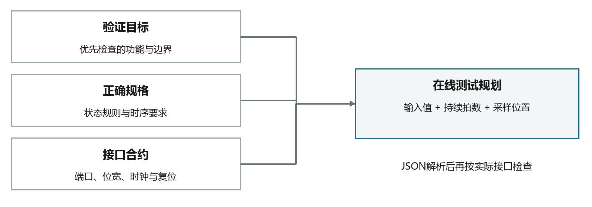
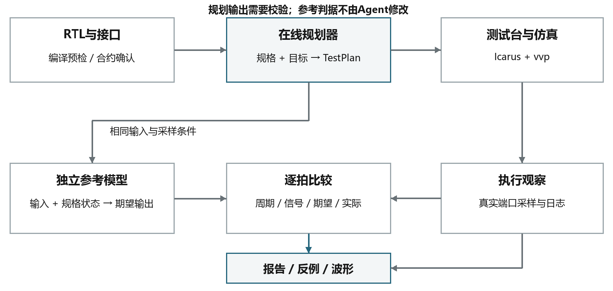
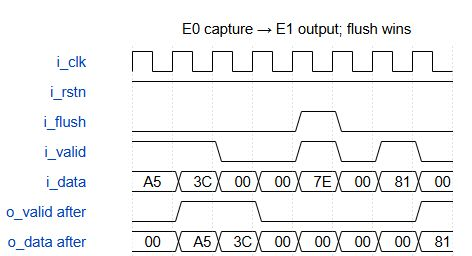
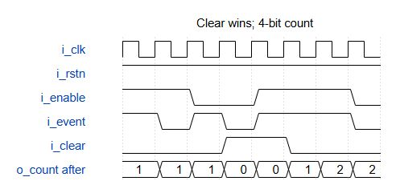
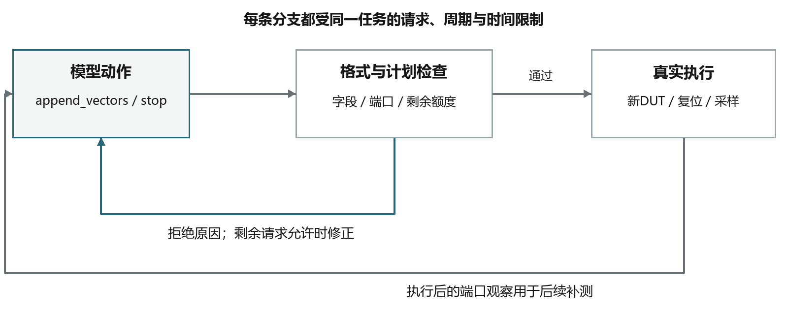
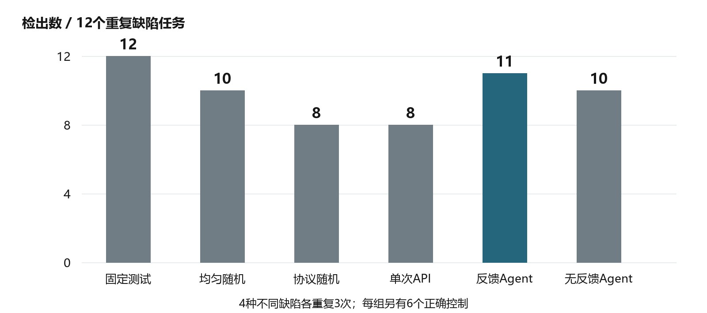
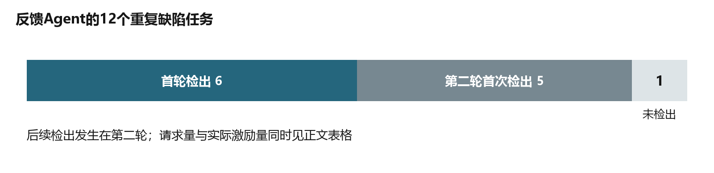

# ICARUS数字IP验证智能体

AI＋集成电路技术报告

## 摘要

ICARUS是一套面向数字IP的RTL功能验证工具。我们将在线大模型接入本地仿真流程，使用模型分析功能规格和验证目标，生成包含输入取值、持续周期与采样方式的测试计划，再由程序生成测试台并调用Icarus Verilog执行。对于已有参考模型的模块，系统按时钟周期计算期望输出，与被测电路的真实输出进行比较。首次测试结束后，自动验证Agent可以根据端口观察继续提出激励，检查首轮没有触发的状态和控制信号组合。

设计中需要处理的主要问题是模型输出与硬件执行条件之间的对应关系。为此，我们使用DutContract统一端口、位宽、时钟和复位定义，使用TestPlan表达测试输入，并在执行前检查计划是否合法。参考模型与测试生成器分别实现，Agent只能修改激励，不能修改独立判据。测试台对多拍输入逐拍采样，避免只观察最后一拍而遗漏中间错误。

在有效数据流水和事件累计器组成的108任务对照中，反馈Agent检出11/12个重复缺陷任务，单次规划检出8/12个，其中5项反馈检出发生在第二轮；固定测试检出12/12个。六种策略的36个正确控制任务全部执行，均无误报。在判据改进实验中，FIFO的228项输出比较由66项差异降至0项；补充UART位持续时间与忙信号释放检查后，同一组15个人工缺陷变体的检出数由13项增至15项。报告分别说明这些结果对应的实现和实验条件。

关键词：RTL功能验证；测试生成；在线大模型；逐拍比较；反馈补测

## 目录

<!--TOC-->

## 一、作品概述

### 1.1 项目背景

数字电路的功能需要通过输入序列和输出行为来验证。组合逻辑可以直接检查输入与输出的对应关系，时序逻辑还需要考虑复位、历史状态和有效边沿。同一组输入出现在不同状态下，可能产生不同结果。例如，FIFO的写请求在未满时应被接受，在满状态下则应被拒绝；握手级在下游未准备好时，应继续保持数据，不能按普通流水线直接覆盖。

在模块开发中，编写测试台通常需要先阅读端口和规格，确定时钟、复位及采样位置，再将待检查的行为转成一段具体激励。设计改动后，还需要同步调整测试。在线大模型能够辅助理解文字规格，但模型给出的描述只有落到真实输入和比较规则上，才可以用于电路验证。

我们据此开发了ICARUS。作品将大模型用于验证计划生成和后续激励选择，将编译、仿真和输出比较交给本地程序执行，应用于集成电路设计中的模块级RTL验证。作品当前检查的是逻辑行为，不涉及布局布线后的物理时序或芯片测试。

### 1.2 设计目标

本项目的目标是让用户从一份RTL及其功能要求出发，完成测试准备、实际仿真和结果检查。系统需要把“检查复位”“覆盖连续传输”等要求转成可以执行的输入，准确记录测试中的每个有效采样点，并在出现差异后给出对应周期和信号。

我们在设计中保留了人工确认接口和规格的环节。模型可以提出测试方案，但端口方向、时钟条件和正确行为不能随着一次模型回答任意改变。对于需要多拍操作才能触发的缺陷，系统还应允许在已有结果基础上继续补测，并限制每次任务的请求次数和累计激励周期。

| 设计目标 | 当前实现与评价方式 |
|---|---|
| 将文字要求转成测试 | 规格、验证目标和接口合约共同输入在线规划器，输出结构化计划 |
| 使计划能够实际执行 | 检查字段和端口权限，自动生成测试台，调用Icarus与vvp |
| 检查中间周期的行为 | 对多拍向量逐拍采样，记录期望值、实际值及首次差异 |
| 利用仿真结果继续测试 | Agent读取允许提供的端口摘要，在剩余额度内提出新激励 |
| 支持复查与重新运行 | 保存源码、合约、计划、测试台、日志和波形的对应关系 |

### 1.3 开发环境

系统主体使用Python实现，网页采用Streamlit，命令行与网页共用核心验证模块。Icarus Verilog负责RTL编译和仿真，vvp执行编译产物，GTKWave用于查看VCD波形。Yosys用于可选的综合与结构检查，不参与模型推理，也不替代功能仿真。

AI规划通过DeepSeek在线API完成。实验记录中的模型标识为deepseek-flash，对应项目使用的4.1f配置；本机不加载模型权重。测试输入、仿真进程和结果处理在本地完成，API配置与运行材料分别管理。

## 二、需求分析

### 2.1 多拍行为的测试需求

状态错误通常需要一段连续操作才能显现。以FIFO为例，单独检查一次写入和一次读出，不能确认同拍读写时占用量是否保持，也不能确认指针回绕后读出的顺序是否正确。UART需要观察完整发送过程，检查数据内容的同时还要检查每一位的持续时间。流水模块则需要同时处理有效数据、空拍和清空操作，输出有效标志必须与对应数据对齐。

如果测试只在每段输入结束时读取输出，段内出现又恢复的错误可能被遗漏。我们将“输入保持多少拍”和“哪些拍需要检查”分别定义，使持续激励不会减少实际采样次数。对已有逐拍参考模型的设计，保持N拍的输入应产生N拍观察，而不是只留下最后一个值。

### 2.2 输出判据的需求

测试台运行结束，并不一定已经检查过功能。只有输入激励而没有预期输出、参考模型或有效断言时，仿真能够生成波形，但无法据此判定RTL符合规格。用户输入“测试是否符合协议”，也不能直接补出协议中的全部时序要求。

参考模型本身同样需要检查。我们在FIFO案例中发现，原RTL和原参考模型曾经保留了相同的计数错误，两者相互比较时可以一致。为解决这一问题，重放与回归检查采用独立队列表示数据次序和占用量，对照真实RTL及运行时参考模型的输出。产品运行时参考模型仍维护指针和计数状态。正确行为应从规格得到，不能仅由两份实现结果相同来确定。

系统需要在报告中给出检查数量，并说明期望值来自哪里。AI生成的预期输出可以作为计划内容，但其可靠程度取决于规格和人工检查；独立参考模型则可以在支持的接口条件下提供程序化判据。两者在结果中分别标记，避免把模型猜测写成独立验证结论。

### 2.3 实际导入中的问题

首次异机使用记录反映了源码准备和结果阅读方面的需求。用户上传的文件包含one_wire_master_byte顶层模块，但内部还例化了one_wire_master_bit。缺少后者的源码，Icarus不能完成展开，后续仿真也就没有实际输出记录。文件名与模块名是否相同不是这一错误的原因。

另一个问题是没有设置可用的输出判据。已有导出计划中，4组向量合计12个激励周期，预期值与断言均为空；同时，编译阶段已经失败。页面中的“0项比对”对应没有产生实际功能比较，不能解释为全部测试通过。

后续用户使用包含两个模块的替换源码继续测试。导出的成功运行包包含15组向量、22个激励周期和42项实际比较，全部一致，编译、仿真及报告和波形导出均已完成。该记录补充了首次编译失败后的使用结果；期望值来自AI生成计划，实际时钟为65ns，不能据此写成完整OneWire协议或精确16MHz时序验证通过。[11]

这类情况要求系统先检查源码和接口，再执行计划；发生失败后，还应区分编译失败、仿真失败和功能差异。用户需要据此判断应补充依赖文件、调整测试条件，还是修正RTL逻辑。多文件上传后的include语义仍存在教师复核指出的问题，尚需修复。[12]

### 2.4 功能要求与实现约束

作品主要服务于模块开发和教学实验。前者需要从规格得到具体激励并定位反例，后者还需要理解复位、采样和状态转换的关系。两种任务都要求输入可检查、结果可解释。

我们据此确定了两个实现约束。第一，模型输出以数据形式进入工具链，不允许直接执行回答中的Verilog代码或命令。第二，每次测试使用明确的初始状态和采样关系，后续补测不能默认继承一个已经结束的仿真进程。接口合约、计划校验和独立执行模式均由这两个约束展开。

## 三、AI技术工具选择与运用

### 3.1 在线模型的选用

项目选用DeepSeek在线API处理文字规格与测试规划。本项目需要模型理解控制信号的作用，组织连续输入，并按固定结构返回结果。API方式可以把模型推理与本地仿真分开部署，另一台电脑只需准备Python环境、仿真工具和API配置，不需要安装本地推理框架。

模型在系统中负责初始测试计划生成和自动补测决策。初始规划将目标转换为一组测试向量；补测决策则结合已经执行的计划和允许提供的观察，选择下一组输入。项目未进行自有模型训练或权重微调，本文评价的是在线模型与验证程序组合后的实际表现。

### 3.2 验证目标与提示内容

用户填写的验证目标会进入规划请求。程序同时提供模块接口、功能规格和输出格式要求，目标用于确定优先检查的行为，接口用于限定合法信号，规格用于说明这些行为应如何发生。

以有效数据流水为例，只写“覆盖边界”不能说明应如何驱动输入。我们将目标具体描述为：检查连续有效输入的数据次序；在有效输入之间插入空拍；在流水中存在未交付数据时拉高清空信号，并检查清空与新有效输入同时出现的优先级。模型可以据此组织带有持续拍数的输入序列。

请求中的端口信息也参与生成。i_data是8位输入，合法值范围为0至255；i_clk由测试台自动驱动，模型不能将其作为普通输入任意赋值。复位和采样条件随合约一同提供，使“保持两拍”具有一致的执行含义。缺少具体协议规格时，目标文字只能表达测试意图，不能补齐全部协议判据。



### 3.3 结构化测试计划

模型返回的TestPlan使用JSON表达测试名称、输入取值、持续周期和采样位置。初始计划可以包含预期输出，以及程序支持的断言模板。测试台生成器读取这些字段，完成时钟产生、复位、输入驱动和输出记录。

下面给出Agent补测动作的格式示例。该示例只说明字段含义，不是一次新增实验结果。clear与事件同时有效时，正确规格要求清除优先；输入持续一拍后，再解除clear并观察下一拍。具体可用端口仍以本次合约为准。

```json
{
  "action": "append_vectors",
  "reason": "检查清除与许可事件同时出现时的优先级",
  "vectors": [
    { "name": "clear_with_event",
      "inputs": {"i_clear": 1, "i_enable": 1, "i_event": 1},
      "cycles": 1, "sample_phase": "after" },
    { "name": "resume_event",
      "inputs": {"i_clear": 0, "i_enable": 1, "i_event": 1},
      "cycles": 1, "sample_phase": "after" }
  ]
}
```

程序先校验JSON字段，再按接口检查信号名、方向和位宽。模型把输出端口写入inputs、使用不存在的信号，或给出超过位宽的数值，计划都不会进入仿真。断言同样采用预定义模板，模板允许的字段直接参与提示内容生成和解析检查，避免提示要求与实际校验规则不一致。

### 3.4 自动验证Agent

单次规划需要在没有真实输出的条件下完成全部输入选择。自动验证Agent则将一次任务拆成若干轮，每轮执行后再决定是否继续。系统向Agent提供已有计划、剩余额度以及允许反馈的端口采样；已经配置功能场景分析的模块，还可提供未触达的场景信息。

Agent动作只有append_vectors和stop两类，分别表示提出新向量和结束补测。reason记录本轮选择依据，vectors记录实际输入。Agent不允许设置非空expected，也不能改写独立参考模型或覆盖统计。它决定“接下来施加什么输入”，输出是否符合规格仍由本地比较程序判断。

这一方式适用于需要连续操作才能触发的状态，例如填充后再读写FIFO，或在流水中存在有效数据时触发清空。已有首轮测试能够发现简单错误时，多轮补测未必增加收益；后文用完整策略对照说明实际适用范围。

### 3.5 错误修正与请求限制

在线模型可能返回不合法的JSON，也可能在合法结构中加入超额激励。程序记录具体拒绝原因，再在剩余请求额度内允许模型修正。格式失败与计划预算失败分别处理：前者尚未形成可执行动作，后者已经解析出计划，但没有通过执行前检查。两种情况都不能计为已执行测试。

重试与正常补测共用请求上限，不能因一次回答失败而重新获得额度。累计周期也按整个任务计算。程序保存失败响应和已完成轮次，达到限制后停止，将未检出的任务保留在统计分母中。网络错误与格式错误分别记录，避免对相同失败无界请求。

## 四、项目实施

### 4.1 系统总体结构

系统由接口处理、AI规划、测试台生成、仿真执行和结果比较模块组成。网页与命令行负责接收输入并调用这些模块，核心数据对象在两种入口之间共用。用户切换操作入口，不需要重新定义一套测试格式。

图2给出了主要数据流。RTL首先经过接口提取和编译预检，确认后的DutContract与功能规格进入规划器。TestPlan通过检查后生成测试台，与RTL一起编译执行。实际输出送入比较模块，参考模型则根据相同输入和时钟关系计算期望值。Agent读取允许提供的执行观察，再提出下一轮输入。



我们将参考路径与规划路径分开，是为了避免模型在发现差异后同时修改测试和正确答案。受控缺陷对照中，模型接收正确规格和接口，不接收缺陷标签、私有变体源码或预先构造的见证输入。正确侧与候选侧使用相同计划分别运行，保留两侧实际结果。

### 4.2 接口合约与编译预检

DutContract记录顶层模块、端口方向、位宽和参数，并描述时钟、复位及采样条件。端口提取后得到的是接口草稿，仍需要确认参数化位宽和时序设置。用户修改合约后，先前的接口确认失效，新的测试必须重新校验。

时钟和复位直接影响测试含义。以本次流水模块为例，i_clk周期为10ns，上升沿工作，i_rstn异步低有效。独立运行开始时，测试台先施加两拍自动复位，再释放复位并执行输入。未重新指定的业务输入在同一轮中保持原值，不能将JSON省略字段理解为自动归零。

源码预检使用Icarus的null目标进行编译展开，命令包含-tnull、-g2012及顶层选择-s。程序据此检查语法和模块依赖，失败后显示编译诊断并阻断正式运行。预检不施加功能激励，因而不能用预检通过代替功能验证。

对于层次化设计，上传内容必须包含顶层引用的子模块和头文件。one_wire_master_byte导入案例说明，仅识别到顶层端口还不足以运行测试。系统需要以编译展开结果确认源码集合是否完整，而不是只检查文件后缀或端口表。

### 4.3 输入驱动与逐拍采样

Verilog时序逻辑常用非阻塞赋值更新寄存器。如果测试台在同一上升沿立即读取输出，可能读到更新前的值。我们在合约中明确采样阶段，并在支持逐拍参考的测试中使用after采样，使输出观察与该沿完成后的寄存器状态对应。

有效数据流水的两级寄存关系可以说明这个问题。E0上升沿接受输入A5，第一级保存数据；E1上升沿后，第二级输出A5。这里“两级”指E0捕获与E1输出两个寄存采样沿，不应再等待两个额外周期。如果i_flush在某个上升沿为1，两级和输出同时清空，当拍的新有效输入也不被接受。

| 时钟沿 | i_flush | i_valid | i_data | o_valid after | o_data after |
|---|---:|---:|---|---:|---|
| E0 | 0 | 1 | A5 | 0 | 00 |
| E1 | 0 | 1 | 3C | 1 | A5 |
| E2 | 0 | 0 | 00 | 1 | 3C |
| E3 | 0 | 0 | 00 | 0 | 00 |
| E4 | 1 | 1 | 7E | 0 | 00 |
| E5 | 0 | 0 | 00 | 0 | 00 |

图3使用同一正确规格绘制时序。空拍需要在输出端保持无效且数据为0，清空后也不能重新出现旧数据。逐拍比较能够分别检查这些条件；若只观察长向量末尾，输出曾经提前有效或短暂携带旧数据的情况就可能消失。



事件累计器则按每个获许可的事件拍加1，结果取模16。事件持续高电平N拍且每拍使能时，应累计N次，不能只检测一次上升变化。i_clear的优先级高于事件，且不受i_enable限制。参考模型按这些逐拍规则更新状态，再与o_count比较。



图3和图4由WaveDrom生成，表示正确规格中的时序关系；实际仿真过程另存VCD。规格图用于解释期望行为，实际通过情况以逐拍比较和运行记录为依据。

### 4.4 FIFO参考模型与同拍读写

FIFO的主要检查对象是数据顺序、占用量和空满边界。在独立重放与回归检查中，我们使用Python deque保存抽象队列，每拍先根据边沿前的队列长度判断请求是否被接受，再更新队列。这一规格判据不复制RTL的读写指针及寄存器赋值过程。产品运行时oracle仍以存储数组、读写指针和占用计数维护状态，其输出由上述独立队列对照检查；两者用途不同。

设边沿前占用量为count，队列深度为DEPTH，则写接受条件为wr_en且count小于DEPTH，读接受条件为rd_en且count大于0。占用量更新为count_next=count+write_accept-read_accept。同时接受读写时占用量保持；只有写被接受时加1，只有读被接受时减1。

例如，队列原有25和66，同拍接受读请求以及写入99，读出值应为旧队首25，更新后的队列为66和99，占用量仍为2。满状态下的写请求则按边沿前状态拒绝，即使同拍读出一项，也不会追溯改变该写请求的接受结果。

旧RTL在两个独立条件分支中分别执行count的非阻塞赋值，同拍读写时，后一次赋值覆盖前一次赋值，导致占用量错误地减1。原参考模型也保留了这一行为。我们改为按接受情况一次性更新count，并用独立队列重新检查。图5给出了相同76周期激励的比较结果。


| 被测对象 | 激励周期 | 输出比较数 | 与独立队列的差异数 |
|---|---:|---:|---:|
| 修复前FIFO基线 | 76 | 228 | 66 |
| 修复后FIFO基线 | 76 | 228 | 0 |
| 满标志提前一项的缺陷控制 | 76 | 228 | 56 |
| 满状态继续写入的缺陷控制 | 76 | 228 | 46 |

测试包括空满边界、同拍读写、反复填满排空和复位后重新使用。修复前首次差异出现在零起始第6周期的full信号，随后出现提前empty和读数据错误。两个缺陷控制仍然产生差异，说明修复没有通过放宽比较条件掩盖错误。该实验验证的是RTL和判据的修正，不计为AI新发现的缺陷。

### 4.5 UART位时序与完成条件检查

UART发送测试原先主要检查接收端能否还原数据，但接收器存在采样容差。某一位缩短一拍，环回仍可能成功；测试任务等待到超时后直接返回，也无法确认busy是否真的释放。这两个问题分别导致位持续时间错误和忙信号不释放的变体漏检。

我们保留环回数据检查，增加端口级逐周期计时。测试使用相邻位交替的0x55发送8N1帧，使相邻位之间出现明确跳变；分别在prescale=1和prescale=2条件下检查txd窗口。对于本次冻结的外部实现，起始位和各数据位持续8×prescale周期，停止阶段的busy保持为8×prescale+1周期。该完成关系来自被测模块约定，不作为所有UART实现的统一规则。


测试台在negedge驱动输入，在posedge后延迟采样，以避开非阻塞更新竞争。到计算出的完成期限，直接检查busy释放和ready恢复；发送期间则检查ready为低。这样，即使环回字节正确，位持续时间或完成条件错误仍会产生断言失败。

相同24份冻结输入重放后，15个人工缺陷变体的检出数由13项提高到15项。UART正确基线和等价改写均完成773项检查且无失败，3个编译失败控制仍归为不可判定。该提升来自判据补全，实验没有新增API请求，也没有修改候选源码。

### 4.6 功能场景统计

逐拍输出比较回答的是“观察到的输出是否符合规格”，功能场景统计则记录“哪些操作实际发生”。例如，FIFO出现wr_en并不一定完成写入，满状态下请求应被拒绝；握手接口的valid拉高，也不代表下游已经接受数据。

我们依据执行记录中的信号和接受条件统计场景。当前FIFO包含7项，UART包含6项，SPI示例包含6项，握手级包含5项，共24项有限场景。具体场景由程序判定，模型不能将一个未被接受的输入请求自行标为命中。

这些统计用于辅助补测，不等同于RTL代码覆盖率。新加入的有效数据流水和事件累计器尚未配置专用场景项，报告保留unsupported或unknown状态，不能因为已取得端口输出就填入覆盖百分比。

### 4.7 Agent执行状态与反馈

每一轮补测需要明确从什么状态开始。独立运行模式会重新建立DUT并复位，只执行本轮输入；累计重放模式则从复位开始重放已有计划，再追加新输入。两种模式都使用新的仿真实例，不能将上一轮最终寄存器值直接当成下一轮初始值。

如果Agent计划先填充FIFO再检查满状态，独立模式下必须在当前轮重新给出填充过程。累计模式可以重放旧输入，但重放周期也要计入额度。我们将执行模式和剩余周期写入模型状态，避免出现“推理时假定已填满，实际仿真却刚复位”的情况。

端口反馈从实际执行记录生成。摘要最多返回12个确定性的端点或等间隔样本，保留位字符串及X/Z，并注明省略数量；完整逐拍比较仍读取全量记录。对超长结果进行压缩，是为了控制请求长度，不能把摘要长度误认为实际执行周期数。



图7中的拒绝分支不会执行DUT，也不会产生功能观察。程序在收到可执行动作后才生成测试台，完成仿真后才更新观察。发现反例、模型停止或耗尽额度都会结束任务，并保存已经完成的轮次。

### 4.8 实施过程与运行资料

项目实施先完成接口、测试计划与仿真执行的连接，再补充逐拍参考模型和受限断言，随后接入多轮Agent与完整对照。协议判据检查中发现的FIFO计数和UART计时问题，分别用固定输入重现并修正。两类新模块的测试则用于观察现有Agent在不同状态规则下的表现。

开发资源主要包括本地Python环境、Icarus工具链和在线API。接口与执行部分维护合约和测试台，参考部分实现规格判据，Agent部分处理动作、反馈及请求限制，各部分通过相同计划和运行记录联调。已有记录包含10月4日的协议判据实验、10月5日的API对照、10月7日的规格波形整理及10月13日的异机操作问题归档。

每次运行保存源码、合约、计划、测试台、编译日志、仿真输出和VCD，并建立文件摘要清单。文件摘要用于确认结果与输入是否对应；重新运行时应使用新的输出目录，保留原始失败和旧结果。API轨迹另外保存请求、响应、拒绝原因和用量，便于复查模型在每轮实际收到的信息。

## 五、应用成效

### 5.1 完整对照的实验设置

我们选用有效数据流水和许可事件累计器进行六种策略对照。每类模块包含一个正确实现及两个缺陷实现，每种策略对每份实现重复3次，共2×3×3×6=108个登记任务。每种策略对应12个重复缺陷任务和6个正确控制任务；12个缺陷任务实际由4个不同缺陷各重复3次构成。

固定测试根据正确规格编写；均匀随机生成独立随机输入段；协议随机按正确规格组织输入。单次API规划最多请求1次，反馈Agent和无反馈Agent最多请求3次。无反馈组隐藏端口观察和拒绝诊断，但仍保留自己的计划、剩余额度及执行器早停信息。

各任务共享24个累计激励周期上限，每次提案最多12个输入段。自动初始复位单独统计，不刷新刺激额度。候选侧与正确侧使用相同输入，全部真实输出按after逐拍检查。108个任务均实际执行，共134轮、268次候选或正确侧执行。[1]

### 5.2 检出结果与实际资源

表中同时列出检出、请求和候选侧实际激励量。正确侧使用相同输入，其执行周期另计；自动初始复位不包含在本列内。统一上限可以限制不同策略的最大投入，但实际执行量仍会受计划长度和早停影响，不能将其描述为消耗完全相等。

| 策略 | 检出/12 | API请求数 | 候选侧激励周期 | 输入＋输出tokens |
|---|---:|---:|---:|---:|
| 固定测试 | 12/12 | 0 | 432 | 0 |
| 均匀随机 | 10/12 | 0 | 432 | 0 |
| 协议随机 | 8/12 | 0 | 432 | 0 |
| 单次API规划 | 8/12 | 18 | 236 | 61,529 |
| 反馈Agent | 11/12 | 38 | 300 | 166,073 |
| 无反馈Agent | 10/12 | 31 | 290 | 112,022 |



反馈Agent比单次规划多检出3个重复任务，检出比例由66.7%变为91.7%，相差25个百分点。反馈组11项检出中，6项发生在第一轮，5项发生在第二轮。后续输入确实触发了首轮没有发现的错误，但反馈组也使用了更多请求和激励周期，不能只用3项差值确定反馈本身的因果收益。



随机策略和无反馈Agent均检出10/12个，固定测试以12/12个最高。所有策略在三次重复的并集中都触达了4种缺陷，但各次运行的稳定程度不同。固定测试在这种规格明确、规模较小的模块上仍然有效，AI的用途主要是辅助组织输入和继续探索，不能用本组结果声称全面替代固定测试。

| 模块与缺陷标识 | 固定 | 随机 | 协议随机 | 单次 | 反馈 | 无反馈 |
|---|---:|---:|---:|---:|---:|---:|
| valid_data_pipeline B | 3 | 3 | 3 | 3 | 3 | 3 |
| event_accumulator B | 3 | 3 | 1 | 3 | 3 | 3 |
| valid_data_pipeline C | 3 | 3 | 3 | 1 | 3 | 3 |
| event_accumulator C | 3 | 1 | 1 | 1 | 2 | 1 |

每格最多3，表示同一缺陷的三次重复。差异主要集中在C类变体，而简单变体在多种策略下均可检出。六组共36个正确控制任务全部执行且无误报，给出了这组输入和判据下的正确侧检查结果。

### 5.3 失败动作与资源统计

本批次共完成87次API请求，已报告输入301,910 tokens、输出37,714 tokens，合计339,624 tokens，未报告用量和未完成请求均为0。80轮执行生成了端口摘要，真正进入模型请求的反馈状态有20份。摘要采集数量与API实际收到的数量分别统计。

87份响应中，85份通过动作格式检查，2份被拒绝；已经通过格式检查的提案中另有5次因计划预算被拒。预算拒绝后，有2个任务完成后续执行，其中1个检出缺陷。格式拒绝后，有1个任务完成2轮执行但未检出；另一个任务耗尽请求额度后结束，先前已完成14个激励周期，最终仍按未检出计入分母。

这些记录说明受限重试能够让部分失败提案继续进入执行，也显示它不能保证每个任务都恢复成功。格式错误、预算拒绝和实际执行分别保留，检出率使用全部登记缺陷任务计算，不删除失败后重新取最好结果。

### 5.4 较大模块集合的结果

另一个八模块批次登记432个任务，每组包含48个重复缺陷任务和24个正确控制任务。其中414个任务实际执行，18个没有进入DUT运行；未执行任务含1项正确控制，另有8项任务因token预算边界终止。该批次的严格完整比较资格为false，不能作为全部任务均执行的完整对照。固定、均匀随机、协议随机、单次规划、反馈Agent、无反馈Agent分别检出48、32、48、29、37、37项，分母均为48，未执行任务不从分母删除。[2]

该批次反馈Agent未超过协议随机，也未超过无反馈Agent。较大的任务集合说明，增加模型调用和反馈轮次不会自动带来更高检出。不同模块的规格完整度、随机策略的组织方式以及测试所需的路径长度，都会影响最终结果。

两批实验的模块、执行完整度和实际消耗不同，本文分开报告，不把结果拼接成连续上升曲线。两个新模块的108任务结果支持本样本中的多轮补测作用，八模块结果则保留了AI策略尚未优于强基线的情况。

### 5.5 判据改进带来的变化

FIFO实验首先改变的是正确行为的判断基础。旧RTL与旧参考曾经一致，但独立队列在228次比较中发现66项差异；修复同拍更新后，同一组输入的差异归零。缺陷控制继续被识别，说明比较能够区分正确修复和错误行为。该结果强调，增加测试之前，需要先确认参考模型代表的规格。

UART实验改变的是检查的时间精度。旧测试能够检查字节内容，却遗漏位持续时间和busy完成条件；补充后，同一组15个缺陷的检出由13/15变为15/15，增加2项，约13.3个百分点。正确与等价控制保持无误报。两个实验均使用真实Icarus执行，没有将人工判据修正归因于模型能力提升。[3]

### 5.6 实际使用与应用价值

网页已经提供RTL导入、接口校验、在线规划、计划执行及结果导出。用户可以查看每轮输入、实际比较数和反例，并下载日志与波形，用于进一步调试。图10为已有浏览器截图，展示导入后确认接口再生成计划的操作关系。


已有异机操作真实暴露了工具路径、源码依赖和空判据等问题，首次两份运行包均停在编译阶段。[5] 后续替换源码和配置调整后，用户提供的第5个运行包完成15组、22周期和42项比较，0项不一致，并包含报告与VCD。两个阶段分别归档，首次失败未被覆盖。该结果支持自定义RTL核心操作流程已完成，不代表全部CLI任务或完整协议已复现。[11]

教师使用AI辅助形成了技术交叉复核意见，内容包括原始统计重算、独立测试台及FIFO执行复现，也指出多文件预检和报告披露问题。意见来源和整改状态单独归档，尚未取得教师亲自确认结论的记录，不将生成的复核文本写成独立人工审核通过。[12]

作品在教学和模块开发中的实际作用，是将文字要求转换为可检查的输入，自动执行重复采样与比较，并保留可定位的输出差异。当前没有收集足够的任务耗时记录或付费账单，因此不填写节约工时和经济收益比例。应用成效主要依据实际功能、完整对照和具体判据实验说明。

## 六、总结与展望

### 6.1 设计总结

我们完成了从在线模型测试规划到本地RTL仿真的连接。DutContract使端口和时钟条件在生成、驱动与比较过程中保持一致，TestPlan使模型输出能够被程序检查和执行。多拍向量采用逐拍观察，反例能够落到具体信号和时钟周期。

参考模型的实现影响整个验证结论。FIFO案例说明，照搬RTL赋值过程可能把相同错误带入判据；独立队列和明确的请求接受条件能够发现这类问题。UART案例则说明，只检查最终数据还不够，位时间和完成信号同样属于功能规格。

反馈Agent在两类新模块中补充了首轮未发现的错误，但固定测试仍获得最高检出，八模块对照也没有显示反馈优于全部基线。当前较合适的使用方式，是保留固定和协议随机测试，将AI用于根据规格组织输入、补充连续状态组合，并通过实际对照判断它在哪些任务上有效。

### 6.2 当前不足

通用RTL可以被解析和仿真，但并不都具有可直接使用的独立参考模型。复杂协议尤其依赖外部设备环境、完整时序规格和更长测试路径。当前SPI示例也未覆盖完整标准接口，不能把示例行为检查写成协议认证。

现有缺陷实验以小规模内部设计和人工变体为主，没有证明工业设计上的普遍收益。每种策略只有有限重复次数，模型服务端采样也没有配对固定。较大批次仍存在未执行任务，格式恢复也未覆盖全部失败。异机自定义RTL核心运行已有成功证据，全部实验的异机重放和独立人工复核尚未确认。

### 6.3 后续改进方向

下一步首先扩展参考和环境模型。对OneWire等依赖外部响应的设计，应分别定义主机输入、总线驱动、从设备响应与采样窗口，先用正确实现和故意错误控制检查测试台，再评价AI生成激励。这样可以避免只生成主机侧输入，却缺少协议环境和有效判据。

实验方面，将增加来源独立的模块及未参与开发的缺陷，提前固定规格、策略和预算。除相同上限外，还需要在接近实际请求量和刺激量的条件下进行对照，区分多轮执行增加投入与反馈信息本身的作用。

实际应用方面，将在另一台电脑完成从干净环境到功能结果导出的全流程记录，并由未参与开发的人检查规格、计划和结论。后续收集同一任务的操作时间与问题定位过程，再评价工具在教学和开发中的效率。以上工作作为待验证方向，不计入本报告已取得的成绩。

## 七、附录

### 7.1 数据资料与结果来源

实验数据按批次保存。图5、图8和图9由实际汇总数据绘制，图3与图4为正确规格示意，图10为实际浏览器截图。各类图像的含义在正文中分别说明。

| 编号 | 资料名称与仓库内路径 | 对应内容 |
|---|---|---|
| [1] | docs/experiment/agent_new_holdout_study_live_2026-10-05.md | 两类模块108任务、六种策略、逐轮结果及预算 |
| [2] | docs/experiment/agent_feedback_study_live_2026-10-05.md | 八模块432任务及未执行分母 |
| [3] | docs/experiment/protocol_oracle_improvements_2026-10-04.md | FIFO独立队列及UART计时检查 |
| [4] | docs/experiment/functional_coverage_2026-10-04.md | 24项有限功能场景的定义与记录 |
| [5] | docs/trial/other_pc_user_trial_2026-10-13.md | 真实异机操作问题和导出包分析 |
| [6] | docs/experiment/rtl_spec_rendering_2026-10-07.md | 规格时序图及生成核验记录 |
| [11] | docs/trial/other_pc_user_trial_2026-10-20.md | 后续OneWire核心运行、源码来源及结论范围 |
| [12] | docs/review/teacher_ai_review_response_20261020.md | 教师组织的AI辅助复核意见与整改状态 |

两模块实验的事前方案、原始结果和用量账本分别保存在agent_new_holdout_study_plan_2026-10-05.md、agent-new-holdout-study-live-2026-10-05目录，以及agent_new_holdout_study_budget_2026-10-05.json中，均位于docs/experiment下。结果目录包含full_raw_evidence.zip和full_raw_manifest.json，可以从汇总继续查到原始执行文件。

### 7.2 关键代码与规格

| 代码或资料 | 作用 |
|---|---|
| src/iverilog_ai/ai/planner.py | 组合验证目标、规格和合约，生成初始测试计划 |
| src/iverilog_ai/ai/schema.py | 定义计划、向量和受限断言结构 |
| src/iverilog_ai/ai/agent.py | 补测决策校验、执行模式与请求限制 |
| src/iverilog_ai/core/contracts.py | 端口、时钟、复位和参数定义 |
| src/iverilog_ai/core/rtl_preflight.py | 编译展开预检 |
| src/iverilog_ai/core/testbench.py | 输入驱动及输出采样测试台生成 |
| src/iverilog_ai/core/functional_coverage.py | 已支持模块的功能场景统计 |
| spec/agent_new_holdout_20261005/ | 有效数据流水和事件累计器的正确规格 |

以下为逐拍比较的处理关系示意，不替代仓库实现。参考状态从规格规定的初始条件开始，每拍分别更新参考与采集真实输出，先后顺序由统一采样条件确定。

```text
reference_state = reset_state(contract)
for cycle in executed_input_cycles:
    reference_state, expected = reference_step(reference_state, cycle.inputs)
    observed = read_actual_outputs(cycle, phase="after")
    compare(expected, observed, cycle.index)
save_first_difference_and_full_records()
```

### 7.3 复现与使用资料

初始计划生成器在TestPlan严格校验前执行两项确定性归一化。重复向量名按出现顺序加后缀；reset对象删除不在允许集合中的键，缺少signal且恰有一个额外键时，可将该键推断为signal。该处理可能改变复位字段的解释，因此初始计划的校验通过率应注明经过归一化，不能作为原始响应无需修复的格式成功率。Agent动作的严格格式统计与这一路径分别解释。

使用入口见docs/reproduce_current.md，首次安装、工具检查及另一台电脑的操作记录表均由该指南链接。复现应记录操作系统、Python与Icarus版本、实际工具路径、源码标识、执行命令和最终结果；失败记录同样保留。API密钥不应写入共享报告或录屏。

项目源码仓库为https://github.com/TYOCT-13/iverilog-ai-lab。精确重放历史实验应读取对应目录的输入快照与清单，不能用当前源码重新生成后覆盖原记录。历史云端全仓检查曾失败，最新提交的远端结果需要另行核实。异机自定义RTL核心运行已有后续证据，但全部实验重放和独立人工复核尚未确认；这些状态与运行成功的范围分别记录。

### 7.4 参考资料

[7] AIC竞赛组委会．AIC·AI＋集成电路竞赛规则及作品提交要求，附件1．

[8] AIC竞赛组委会．AIC·AI＋集成电路技术报告参考大纲，附件2．

[9] 本项目功能规格．spec/sync_fifo_spec.md、spec/uart_tx_spec.md、spec/spi_master_spec.md及spec/handshake_stage_spec.md．具体实验参数以原始登记为准。

[10] 本项目接口、计划和参考比较实现．src/iverilog_ai/ai/与src/iverilog_ai/core/．本文所述行为以相应代码及运行记录交叉检查。
