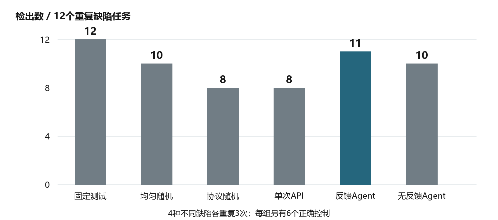
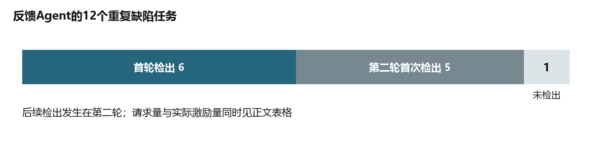
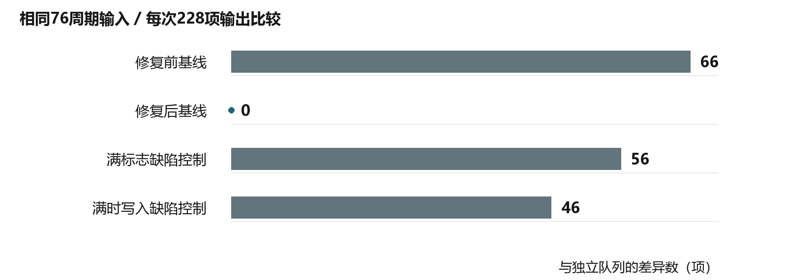
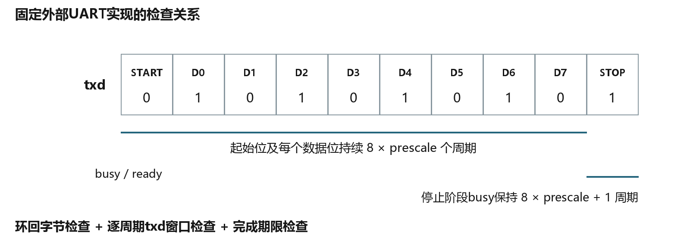
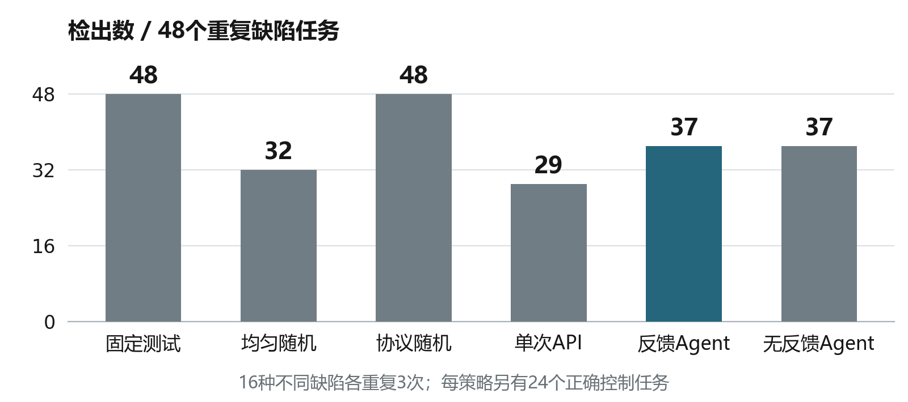
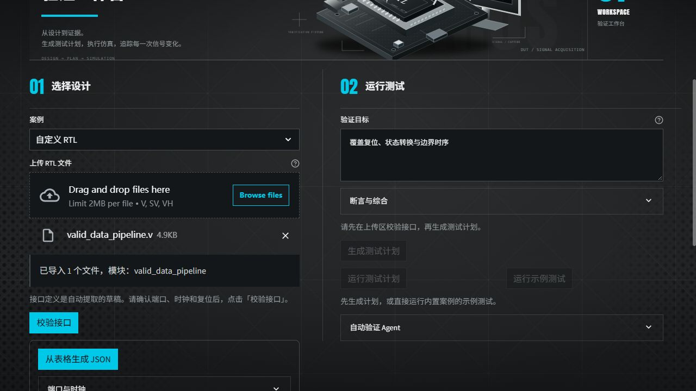

<!-- header: ICARUS · Verification Evidence / 验证佐证 -->
<!-- doctitle: 数字IP验证智能体 / 佐证材料 v4 -->

# ICARUS数字IP验证智能体

佐证材料 · v4 · 2026-10-21

本文件汇总《技术报告》全部实验数字的原始记录出处，与报告正文逐项对应。所有数字取自机器执行记录、预算账本与运行回执，可按第七页的路径直接复查。

## V40　证据索引与版本

原始记录均位于公开仓库，下文路径以仓库的 docs/ 目录为根。浏览时把相对路径接在
https://github.com/TYOCT-13/iverilog-ai-lab/blob/main/docs/ 之后即可直接打开。

- V41 两类新模块108任务六策略受控实验（图1）：experiment/agent-new-holdout-study-live-2026-10-05/
- V42 反馈Agent检出轮次与API用量账本（图2）：同上目录的 token_budget.json、trace_manifest.json
- V43 独立参考判据：FIFO与UART（图3、图4）：experiment/protocol_oracle_improvements_2026-10-04.md
- V44 八模块432任务扩展批次（图5）：experiment/agent-feedback-study-live-2026-10-05/
- V45 异机实机运行与云端检查（图6）：trial/other_pc_user_trial_2026-10-20.md、experiment/multifile-ci-ppt-2026-10-21/actions_receipt.json
- V46 验证范围与复查入口：公开仓库

| 版本项 | 标识 |
|---|---|
| 实验源码（108任务与432任务批次） | 20400fa |
| 冻结Agent、helper与系统提示 | a969337 |
| 当前发布源码 | e57ba12 |
| 本文件生成日期 | 2026-10-21 |

公开仓库：https://github.com/TYOCT-13/iverilog-ai-lab

材料性质：本文件为机器执行记录的汇总，不含真人试用统计或第三方鉴定结论。

<!-- pagebreak -->

## V41　两类新模块108任务完整受控实验

被测对象是两类全新内部模块：两级有效数据流水与许可事件模16累计器。每个模块含1份正确实现与2份注入典型时序、控制缺陷的实现，六种验证策略各独立重复3次。全部108个任务于2026-10-05（UTC）实际执行，累计134轮迭代、268次候选侧与正确侧执行。

| 实验要素 | 登记与实际结果 |
|---|---|
| 任务构成 | 2模块×3实现×3重复×6策略＝108任务 |
| 缺陷分母 | 每策略12任务＝4种不同缺陷×3重复 |
| 正确控制 | 每策略6任务，合计36个；36/36实际执行，误报0 |
| 预算与执行 | 单任务累计24个激励周期上限、单次提案最多12个输入段；每轮独立仿真进程、自动复位，输出按after相位逐拍判定 |

| 验证策略 | 检出/12 | 检出率 | 各重复/4 | API请求 | 候选侧周期 | tokens |
|---|---:|---:|---|---:|---:|---:|
| 固定测试 | 12 | 100.0% | 4/4/4 | 0 | 432 | 0 |
| 均匀随机 | 10 | 83.3% | 4/3/3 | 0 | 432 | 0 |
| 协议随机 | 8 | 66.7% | 4/2/2 | 0 | 432 | 0 |
| 单次API规划 | 8 | 66.7% | 2/2/4 | 18 | 236 | 61529 |
| 反馈Agent | 11 | 91.7% | 4/4/3 | 38 | 300 | 166073 |
| 无反馈Agent | 10 | 83.3% | 3/3/4 | 31 | 290 | 112022 |

反馈Agent检出11/12（91.7%），较单次API开环规划的8/12（66.7%）高出25.0个百分点；其中5项缺陷是在首轮未触发差异、第二轮读取真实端口摘要后追加定向激励才检出的。全部36个正确控制任务完成仿真且误报为0。

<!-- pagebreak -->

## V42　反馈Agent的检出轮次与API用量账本

11项成功检出中，6项在首轮初始计划直接命中，5项在第二轮补测检出；剩余1项在请求额度耗尽后停止。该分布说明多轮闭环真正覆盖了开环规划触达不到的深层状态与控制优先级组合。

| 账本口径 | 实际数量 |
|---|---|
| 收费API请求 | 87次（DeepSeek deepseek-flash，非流式、thinking关闭） |
| tokens | 输入301910＋输出37714＝339624 |
| 动作格式校验 | 85份通过、2份拒绝，一次通过率97.7% |
| 计划预算拒绝 | 5份（属格式通过后的预检子集，不与格式拒绝相加） |
| 真实端口摘要 | 80轮、826个采样点，其中701个回传、125个按固定规则省略 |
| 引入模型的反馈摘要 | 20个计费请求携带端口摘要；无反馈对照组隐藏全部观察与诊断 |
| 用量缺失记录 | 0 |

87份模型原始响应全部留存，格式拒绝已付9274 tokens、预算拒绝已付23991 tokens，均纳入339624总账。请求上限、累计周期与超时在任务生命周期内统一核算：错误重试与正常补测共享同一额度，格式失败不会重置或补偿请求数。

<!-- pagebreak -->

## V43　独立参考判据：FIFO与UART

### FIFO独立抽象队列

同步FIFO的早期缺陷是原始RTL与原始参考模型在同拍读写分支保留了同一个计数覆盖错误，两者互相比对无法暴露问题。改用Python双端队列作为独立判据后，在同一组76周期激励、228项逐拍输出比较中一次性暴露66项差异；修正基准后差异归零，而两类人工注入的空满边界缺陷变体继续被检出56项与46项。

| 被测对象 | 激励周期 | 逐拍比较 | 与独立队列的差异 |
|---|---:|---:|---:|
| 修复前FIFO基线（含同拍读写计数覆盖） | 76 | 228 | 66 |
| 修复后FIFO正确基线 | 76 | 228 | 0 |
| 满标志提前置位缺陷变体 | 76 | 228 | 56 |
| 满状态继续写入覆盖缺陷变体 | 76 | 228 | 46 |

独立判据对同拍读写的裁决规则如下，测试台只观察队列长度与读出的数据，不复制RTL的指针分支：

| 语义场景 | 独立判据给出的结果 |
|---|---|
| 队列含25、66，同拍读出并写入99 | 读出25；队列变为66、99；占用量保持2 |
| 队列已满时到达写请求 | 拒绝写入，即使同拍有读出也不回溯改变本拍判定 |
| 队列为空时到达读请求 | 拒绝读出，占用量不减且不下溢 |

<!-- pagebreak -->

### UART端口级逐周期位时序

UART发送器早期仅靠环回接收端还原字节，接收机过采样容差会放过1拍位宽偏差与忙信号粘滞。补齐端口级逐周期位时间窗口与完成期限断言后，在完全相同的冻结输入重放条件下，15个人工注入缺陷变体由13项提升到15项全部检出；正确基线与逻辑等价改写控制组通过773项逐拍检查且误报为0。

| 同字节24个外部目标 | 数量 | 补齐判据后的结果 |
|---|---:|---|
| 正确参考实现 | 3 | 全部通过，无误报 |
| 历史人工缺陷变体 | 15 | 15项全部检出（原判据13项） |
| 逻辑等价改写 | 3 | 全部通过，无误报 |
| 编译失败控制 | 3 | 预检拦截，不计入功能判定 |

有限功能场景统计依据真实仿真轨迹与硬件接受条件裁决，四个协议模块共内置24项场景定义（同步FIFO 7项、UART 6项、SPI 6项、流水线握手5项）。

<!-- pagebreak -->

## V44　八模块432任务扩展批次

八类不同复杂度模块的扩展批次，每策略48个缺陷任务（16种不同缺陷×3重复）与24个正确控制任务，共432个登记任务；其中414个实际进入DUT仿真，18个未执行，缺陷分母按48全额保留。该批次与V41的两模块集合互不重叠，两批结果分别报告，不拼接分母。

| 验证策略 | 检出/48 | 检出率 | 各重复/16 | 请求 | tokens |
|---|---:|---|---:|---:|---:|
| 固定测试 | 48 | 100.0% | 16/16/16 | 0 | 0 |
| 均匀随机 | 32 | 66.7% | 11/11/10 | 0 | 0 |
| 协议随机 | 48 | 100.0% | 16/16/16 | 0 | 0 |
| 单次API规划 | 29 | 60.4% | 12/10/7 | 70 | 205503 |
| 反馈Agent | 37 | 77.1% | 11/16/10 | 122 | 426581 |
| 无反馈Agent | 37 | 77.1% | 12/14/11 | 114 | 341065 |

| 完整性口径 | 实际记录 |
|---|---|
| 任务执行 | 414/432实际执行，18个零DUT；累计484轮、968个执行侧 |
| 正确控制 | 144个中143个实际执行，误报0 |
| API总账 | 306次请求、973149 tokens |
| 拒绝与恢复 | 格式拒绝18次后12条轨迹完成执行、5项检出；预算拒绝16次后9条轨迹执行、4项检出 |

在该批次上，反馈Agent检出37/48（77.1%），较单次API规划的29/48（60.4%）高出16.7个百分点；针对协议深度定制的随机基线同样达到48/48。模块规范越完备、协议先验越强，纯随机组织输入的效率越高——这正是下一步为总线主控模块构建从机响应环境的直接依据。

<!-- pagebreak -->

## V45　异机实机运行与云端检查

真实用户在另一台电脑导入自定义OneWire多文件RTL（顶层one_wire_master_byte调用底层one_wire_master_bit），系统在多文件编译预检通过后完成编译、仿真、逐拍比对与波形导出。

| 运行包 | 向量 / 周期 | 比较 / 不一致 | 结论与条件 |
|---|---|---|---|
| 首次两份 | — | 0 / — | 缺底层子模块，编译阶段即被预检拦截 |
| 第4包 | 12 / 49 | 30 / 7 | 检出功能差异（10ns时钟） |
| 第5包 | 15 / 22 | 42 / 0 | 全部一致，报告与VCD波形已导出（65ns时钟） |

| 交付与核对项 | 记录 |
|---|---|
| 替换源码包 | OneWire_replacement_20261017.zip，25个成员SHA全部匹配；两模块去注释与空白后与归档件内容一致 |
| 归档开发者测试 | 16MHz与100MHz两组各595项检查、0错误 |
| 云端检查 | 源码e57ba12，2026-10-21，CI四作业（ubuntu 3.11/3.12、windows 3.11/3.12）与verify作业全部success |

云端运行记录：https://github.com/TYOCT-13/iverilog-ai-lab/actions/runs/39456072311 与 /39456072271。

这轮实测直接推动了多文件联合编译预检、头文件自动挂载与未定义宏拦截三项加固。

<!-- pagebreak -->

## V46　验证范围与复查入口

本作品验证的是数字IP模块级RTL的功能行为：接口契约、结构化测试计划、逐拍输出比对、反例定位与证据归档。覆盖对象为内置四类协议模块（同步FIFO、UART发送器、SPI主控、流水线握手）与两类合成基准模块（有效数据流水、事件累计器）。不涉及后端时序签核、物理设计、芯片流片与工业协议认证。

复查入口如下，路径以仓库的 docs/ 为根，完整地址为
https://github.com/TYOCT-13/iverilog-ai-lab/blob/main/docs/ + 下列路径：

- experiment/agent-new-holdout-study-live-2026-10-05/receipt.json —— 108任务的执行索引、分母与统计
- 同上目录 full_raw_manifest.json —— 原件成员集合与SHA，含full_raw_evidence.zip共4359个成员
- 同上目录 registered_inputs.zip —— 458份注册输入的原字节
- experiment/agent-feedback-study-live-2026-10-05/receipt.json —— 432任务批次的执行与完整性记录
- experiment/protocol_oracle_improvements_2026-10-04.md —— FIFO独立队列与UART时序判据的修正原件
- trial/evidence_20261020/receipt.json —— 异机两包的比较数、时钟配置与RTL SHA
- experiment/multifile-ci-ppt-2026-10-21/actions_receipt.json —— 云端检查回执与运行链接
- https://github.com/TYOCT-13/iverilog-ai-lab —— 公开代码与全部实验记录

复查方式：每个运行目录内的manifest记录原件成员与SHA，逐项重算即可核对本文件引用的数字；代码仓库的LICENSE、NOTICE与THIRD_PARTY.md分别说明自研部分许可与第三方组件归属。
