<!-- header: ICARUS · AI＋集成电路 -->
<!-- doctitle: 数字IP验证智能体 / 技术方案 v4 -->

# ICARUS数字IP验证智能体

AI＋集成电路技术方案 · v4 · 2026-10-13

> ICARUS面向数字IP的模块级RTL功能验证，将自然语言规格、受约束的AI测试规划、Icarus真实编译仿真、独立参考判据和证据归档连接起来。作品使用DeepSeek API推理，不训练本地模型。最新内部合成两模块实验共108任务，全部实际执行；反馈Agent检出11/12重复缺陷任务，固定测试为12/12，36/36正确控制无误报。报告以证据说明从动作格式、判据、逐拍采样到工程搬运和用户界面的迭代，同时披露历史432任务的执行缺口、当前云端检查失败、异机用户两次编译失败和独立人工复核待补。当前价值在于形成可执行、可复查、可交接的验证流程，尚无工业泛化、显著性或成本收益证明。

## 一、作品摘要：用真实执行约束AI建议

**让测试建议进入确定的执行流程，让结论回到规格、逐拍输出和原始证据。**

数字IP的验证需要回答三个问题：输入是否符合接口约束，电路是否实际完成仿真，输出是否满足正确规格。ICARUS把这三个问题分开处理。AI负责提出输入序列和补测理由，工具负责检查计划并执行Verilog，独立判据负责比较真实输出。网页与命令行入口保存计划、编译日志、运行日志、波形、停止原因和用量，使结果能够离线复查。

本版补充了10月7日至13日的工程与用户证据。六份RTL另建维护版本，严格样式检查为零错误、零警告；同组双侧仿真和规格重建记录保持可核对。另一台电脑的真实用户操作暴露11项安装、路径、判据及界面问题，已有对应改动发布，但两次上传运行均因缺少依赖模块停在编译阶段，修复后的用户复测尚未确认。

最新108任务和历史432任务分别报告。最新反馈组在本样本中高于均匀随机与无反馈各一个任务，固定测试仍领先；历史反馈与无反馈同为37/48。这些结果说明闭环可以产生可执行补测，不能证明反馈因果、统计显著或工业设计泛化。当前提交的云端自动检查未通过，独立人工复核与异机完整复现仍是下一阶段工作。

本报告更新实施与工程状态，保留历史实验、v3材料和首次失败原件。

| 证据范围 | 已记录事实 | 结论边界 |
| --- | --- | --- |
| 最新内部两模块 | 108任务实际执行；134轮／268侧 | 同团队合成模块，非外部盲测 |
| 反馈规划与控制 | 11/12检出；36/36正确控制无误报 | 4个不同缺陷各重复3次 |
| API资源 | 87请求；339624输入加输出tokens | 模型报告用量，未取得实付账单 |
| 真实用户操作 | 异机11项问题；2次编译失败 | 有AI协助，完整复测与H02待补 |

来源（仓库根相对路径）：[docs/experiment/agent_new_holdout_study_live_2026-10-05.md](../../../../docs/experiment/agent_new_holdout_study_live_2026-10-05.md)；[docs/experiment/agent_feedback_study_live_2026-10-05.md](../../../../docs/experiment/agent_feedback_study_live_2026-10-05.md)；[docs/trial/other_pc_user_trial_2026-10-13.md](../../../../docs/trial/other_pc_user_trial_2026-10-13.md)；[docs/experiment/rtl_style_maintenance_2026-10-07.md](../../../../docs/experiment/rtl_style_maintenance_2026-10-07.md)。

<!-- pagebreak -->

## 二、需求分析：与AI＋集成电路赛题的对应

**选择数字IP功能验证这一具体环节，把AI能力落实为可检查的开发辅助。**

模块级验证的困难常发生在边界和交互，而不是单次正常输入。FIFO空满时请求是否接受，清空是否压过有效输入，事件累计是否受许可控制，UART的位持续时间和busy释放是否正确，都需要多拍激励和明确观察时点。只检查最终输出会遗漏中间错误；只看到进程退出码又无法区分执行完成、功能符合预期和没有有效检查。

需求来自项目自身的学习与开发任务，并在真实异机操作中得到具体补充。初学者需要知道安装哪些工具、在哪里启动、下一步点击什么；编写RTL的开发者需要把规格转成可运行计划；复核者需要看到原输入、真实日志、判据和完整分母。这里按任务划分使用场景，没有虚构访谈人数、需求问卷、节省时间或用户满意度。

作品与AI＋集成电路主题的关联是把模型推理嵌入数字设计验证流程。模型在规格和合约范围内提出测试，Icarus执行实际RTL，参考判据回算正确行为。创新点落在职责分工、受控闭环和证据交接；应用效果通过缺陷对照、正确控制与真实操作问题说明。官方需求、创新、效果、总结四项方向据此对应，不据此预测比赛得分。

验收目标既包含功能，也包含失败的表达。合法计划应实际执行并留下可解释的检查；非法计划应在执行前拒绝，缺模块等编译问题应尽早说明；没有判据或没有仿真应保留未得出结论。验证报告应能让使用者明确停止阶段，并让另一人按同一输入检查结果，而不是依赖AI对自身答案的评价。

当前对象是接口和行为可以明确描述的小型数字IP。作品没有复杂SoC、物理设计、时序签核、芯片上板或工业部署证据。进一步推广需要外部设计、真实使用者和独立审核支持，不能把学习场景中的可运行流程直接扩写成替代专业验证人员的承诺。

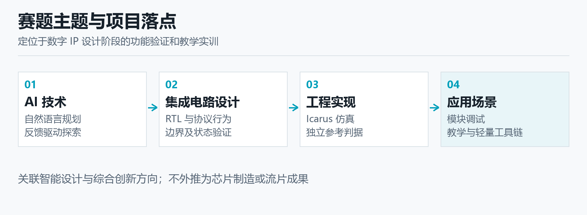

图1　需求任务、作品实现与比赛评价方向的对应；评价方向不等于已取得分数。

| 实际需求 | 对应实现 | 可检查产物 |
| --- | --- | --- |
| 把规格转成输入 | 明确DutContract与严格TestPlan | 合约、已校验计划 |
| 检查边界和多拍行为 | 独立episode与逐拍参考比较 | 采样、反例、波形 |
| 解释为何停止 | 格式／预算／工具／功能分层 | 固定错误码与原日志 |
| 交给他人复查 | 输入指纹、清单和离线证据包 | 原字节、轨迹、回执 |

来源：[docs/competition/ic/v3/technical_report.md](../../../../docs/competition/ic/v3/technical_report.md)；[docs/competition/ic/gap_checklist.md](../../../../docs/competition/ic/gap_checklist.md)；[docs/trial/other_pc_user_trial_2026-10-13.md](../../../../docs/trial/other_pc_user_trial_2026-10-13.md)。官方主题与大纲入口：[官方主题赛通知](https://www.aicomp.cn/notice/4756.html)。

<!-- pagebreak -->

## 三、实施路线：由失败推动的连续迭代

**每次改进都有触发问题、实现变化和验证边界，旧失败保留为历史依据。**

最早的开发对照提示了两个问题：计划可能因格式或权限不符合合约而不能执行，参考模型也可能把正确设计误判。后续c7批次虽然记录252任务终态，却有125行完全没有仿真轮，137次动作校验拒绝。因此这一批不能当作252次有效功能验证，也不能从少量检出推断AI增益。失败记录推动项目优先修正动作协议与执行证据。

动作改成带类型的结构后，v4烟测94个响应全部通过schema、权限拒绝为零，但仍有一项UART正确基线因测试台生成失败而没有执行。这说明格式通过只是进入执行的条件。随后项目增加独立episode、每拍检查、独立FIFO队列判据和分层停止原因，使合法动作、工具执行与正确性判断分别有证据，不再用一个成功标志覆盖全过程。

在受限恢复和共享账本实现后，完整实验保留格式拒绝、预算拒绝、零执行和提前停止。Agent、端口反馈helper及系统提示冻结于a969337，再加入两类内部合成模块；实际最新实验源码为20400fa。108任务全部实际执行，并完成双侧和轨迹审核。这里证明的是该批证据齐全，不把冻结日期解释为外部作者独立性或预训练未见。

10月7日后的维护转向工程可搬运性。六份RTL另建样式维护版，修正命名、控制表达和规格图编码；干净克隆发现锁依赖、长路径、换行和Yosys路径问题；实际GitHub runner继续暴露依赖、历史深度、编码和冻结辅助器路径假设。这些改动解决软件运行条件，旧模型成绩仍属于原始源码与登记输入。

10月13日的异机操作进一步暴露安装顺序、工具路径、缺少子模块、无输出判据以及入口辨识问题。项目据此前置编译和接口校验，折叠详细表单、公开关键操作并修订手册。迭代逐步建立了从问题到守门、执行和复查的对应关系：不能编译的输入先处理依赖，没有判据的计划不记功能通过，界面卡点关联具体操作。效果与未完成状态见第10—13页。

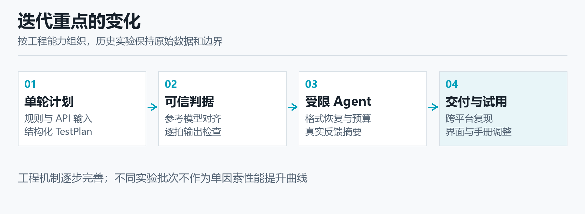

图2　从动作拒绝、判据纠错到可搬运工程和真实使用问题的迭代路线；各阶段成绩分别归档。

| 阶段 | 主要变化 | 保留的限制 |
| --- | --- | --- |
| 开发对照 | 暴露无仿真与格式拒绝 | 不作为完整公平成绩 |
| 受控闭环 | 结构动作、逐拍检查、独立参考 | 有限合约与有限刺激 |
| 冻结实验 | 108任务双侧证据与用量审核 | 内部合成、固定基线领先 |
| 工程与用户迭代 | 维护、克隆、CI、入口和手册 | 当前CI失败、异机复测待补 |

来源：[docs/experiment/agent_comparison_v2_live_2026-10-04.md](../../../../docs/experiment/agent_comparison_v2_live_2026-10-04.md)；[docs/experiment/agent_comparison_v4_smoke_2026-10-04.md](../../../../docs/experiment/agent_comparison_v4_smoke_2026-10-04.md)；[docs/experiment/agent_new_holdout_study_live_2026-10-05.md](../../../../docs/experiment/agent_new_holdout_study_live_2026-10-05.md)；[docs/experiment/rtl_style_maintenance_2026-10-07.md](../../../../docs/experiment/rtl_style_maintenance_2026-10-07.md)；[docs/experiment/clean_checkout_2026-10-08.md](../../../../docs/experiment/clean_checkout_2026-10-08.md)；[docs/experiment/github_actions_repair_2026-10-08.md](../../../../docs/experiment/github_actions_repair_2026-10-08.md)；[docs/trial/other_pc_user_trial_2026-10-13.md](../../../../docs/trial/other_pc_user_trial_2026-10-13.md)。

<!-- pagebreak -->

## 四、系统架构：规划、执行、判断与归档

**各层职责明确，AI输出经过合约检查才进入真实工具执行。**

系统入口为Streamlit网页和命令行。使用者选择内置案例或导入RTL，给出验证目标和接口合约。计划可以由人工、离线规则或在线API提出，随后进入同一校验与执行链。在线模型的推理在服务商完成，本机负责计划解析、测试台生成、Icarus编译与vvp运行、参考比较和证据导出；项目不修改Icarus源码，也不表示获得其官方背书。

合约层描述模块名、参数、端口方向与位宽、时钟、复位和采样关系。计划层只允许受支持的数据字段，不接受模型给出的任意HDL、命令或文件路径。输入名、数值范围、向量数量、刺激周期和请求额度分别校验。执行器以参数列表启动允许的工具，关闭shell，使用独立目录与固定超时，保存实际命令、返回码和截断标记。

参考层和反馈层使用相同执行事实，但用途不同。参考层依据正确规格复算期望值，用于判定差异；反馈层从真实端口提取有限摘要，供模型决定下一步输入。内部受控实验不把缺陷标签、私有见证、参考源码或期望值泄露给模型。数据来源和职责分开，使检出能够回到独立判据，而不依赖模型是否声称测试成功。

归档层把合约、RTL、计划、测试台、编译与运行日志、输出记录、波形、响应记录、token账本和停止原因关联。内容指纹有助于发现文件错配和修改，证据包能够在不增加API请求的情况下核对已有成绩。哈希用于来源一致性，原日志及独立复核支持执行真实性；若所有关联原件一起被伪造，哈希本身仍不能独立证明真实执行。

报告采用分层语义：运行状态说明工具是否完成，比对情况说明实际检查，设计结论说明本轮发现了什么，期望值来源说明判据强度。编译失败不算功能缺陷；进程退出零、固定ok记录或空期望值也不等于功能通过。可选Yosys综合另列为证据层，未运行的时序、比特流与上板层明确保留，不能由仿真结果补写。

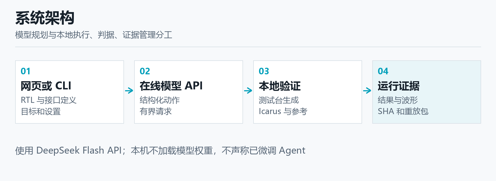

图3　系统数据流与职责：AI提出计划，工具执行RTL，独立判据比较输出，归档保存全过程。

| 层次 | 主要责任 | 代表实现 |
| --- | --- | --- |
| 入口与规划 | 目标、合约、受限动作 | [ui/app.py](../../../../ui/app.py)；[src/iverilog_ai/ai/agent.py](../../../../src/iverilog_ai/ai/agent.py) |
| 校验与执行 | 权限、预算、测试台、进程 | [src/iverilog_ai/core/contracts.py](../../../../src/iverilog_ai/core/contracts.py)；[src/iverilog_ai/core/executor.py](../../../../src/iverilog_ai/core/executor.py) |
| 判断与反馈 | 逐拍参考、真实端口摘要 | [src/iverilog_ai/core/reference_model.py](../../../../src/iverilog_ai/core/reference_model.py)；[src/iverilog_ai/core/observation_feedback.py](../../../../src/iverilog_ai/core/observation_feedback.py) |
| 交接与审核 | 报告、原件、清单、用量 | [src/iverilog_ai/core/report.py](../../../../src/iverilog_ai/core/report.py)；实验回执与manifest |

来源：[docs/architecture.md](../../../../docs/architecture.md)；[src/iverilog_ai/ai/agent.py](../../../../src/iverilog_ai/ai/agent.py)；[src/iverilog_ai/core/executor.py](../../../../src/iverilog_ai/core/executor.py)；[src/iverilog_ai/core/reference_model.py](../../../../src/iverilog_ai/core/reference_model.py)；[src/iverilog_ai/core/observation_feedback.py](../../../../src/iverilog_ai/core/observation_feedback.py)。实现路径均相对仓库根。

<!-- pagebreak -->

## 五、RTL导入：合约确认与编译预检查

**先明确接口并确认源码可编译，使缺失依赖在规划之前暴露。**

自定义RTL导入首先提取可识别的顶层模块与端口，生成接口草稿。草稿不能自动成为可信合约：参数化位宽、时钟边沿、复位有效电平与持续拍数仍需用户确认。网页提供端口表格和JSON的显式转换，确认动作检查合约是否有端口、模块名是否与当前选择一致。编辑后撤销旧确认，避免修改接口后沿用之前已校验的状态。

异机用户只上传onewire_byte_controller.v，其声明模块名one_wire_master_byte合法，内部却实例化未提供的one_wire_master_bit。两次真实编译均报告Unknown module type并退出2。文件名与模块名不同不是这次错误原因；缺少依赖导致编译展开失败，不能说工具发现了one-wire协议功能缺陷，更不能把证据包导出成功算成电路通过。

针对这个问题，f75f619加入上传RTL编译预检查。实现使用Icarus的null目标，按所选顶层解析和展开当前输入及可配置的include、宏定义，在受控路径和超时内保存编译输出；它不生成或执行vvp，不施加功能激励。源码或依赖不能通过检查时，后续验证被阻断，使用户先处理编译问题，再进入需要模型请求和仿真的步骤。

接口校验与编译检查互相补充。接口校验能够发现空端口、名称不符和合约类型问题，但不能证明RTL完整；编译检查能够发现语法、展开和缺失模块，却不能证明端口语义、复位优先级或功能正确。两项都通过后仍需要明确目标、有效输出判据和实际仿真。任何关卡的通过，都只说明其负责的条件已满足。

当前改进已有代码与开发侧检查依据，用户在另一台电脑使用新版本的成功编译证据尚未收到。下一次复测应提供真实依赖RTL的完整清单和指纹，记录新版预检结果，再记录正式编译、运行、输出比较及波形。若后续计划仍没有可执行期望值或断言，应继续提示判据不足，不能通过缩短流程隐藏没有完成的验证。

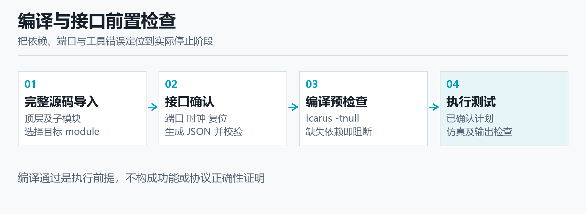

图4　自定义RTL的前置关卡；编译预检查检查可展开性，不执行用户设计，也不判断功能。

| 检查 | 能够发现 | 不能据此推出 |
| --- | --- | --- |
| 接口校验 | 空端口、合约格式、顶层名不符 | 源码依赖完整或行为正确 |
| 编译预检查 | 语法、顶层展开、缺模块 | 有效仿真或功能通过 |
| 计划校验 | 信号权限、数值与刺激预算 | 期望值正确或测试充分 |
| 真实仿真与参考 | 所测逐拍输出差异 | 全输入空间或工业签核 |

来源：[src/iverilog_ai/core/rtl_preflight.py](../../../../src/iverilog_ai/core/rtl_preflight.py)；[ui/app.py](../../../../ui/app.py)；[tests/core/test_rtl_preflight.py](../../../../tests/core/test_rtl_preflight.py)；提交f75f619与7059d25；[docs/trial/other_pc_user_trial_2026-10-13.md](../../../../docs/trial/other_pc_user_trial_2026-10-13.md)。

<!-- pagebreak -->

## 六、AI工具：目标描述与结构化动作

**把模型能力限制在测试规划内，并用固定协议把建议变成可执行输入。**

本项目通过DeepSeek API使用响应记录中的deepseek-flash模型，对应用户所称4.1f。项目没有训练、微调或部署本地权重。选择API的作用是使用现有模型理解规格和组织测试输入，本机仍能以离线规则验证工具链。模型名称、请求设置与用量以实发记录为准，不能用界面选项代替实际请求，也不把服务商模型能力宣称为自主训练成果。

目标描述需要包含正确行为和希望探索的条件，例如连续有效输入与空泡交错、flush同时有效、clear在enable关闭时发生。合约再给出可驱动端口和数值范围，使目标进入明确的操作空间。内部实验传入正确规格、合约、允许输入、历史计划、剩余额度和该策略允许的反馈，不传入目标RTL、缺陷标签、私有见证、参考源码或旧成绩。

Agent动作采用严格结构，包含action、reason与vectors，表示补测或停止。补测只提出受支持的输入段和持续拍数；时钟由工具产生，自动复位由工具执行。模型不能驱动禁止端口、加入任意代码、替换判据或凭空给出测试结果。校验器拒绝未知字段、越界数值和错误类型，为预检失败提供固定诊断；可安全留存的响应保存原文，阻断原文只留SHA、长度与错误码。

结构化协议解决的是动作可解释和可执行性。它并不保证提议触达缺陷，也不保证测试穷尽。烟测中所有响应schema通过而仍有工具失败，最新完整批次中也保留格式终态失败。因此评估需要继续检查实际DUT执行、逐拍比较和完整任务分母，不能把接口兼容、计划可解析或模型理由合理当作功能验证成绩。

最新两个模块的权威参考只授权固定完整合约：无参数、固定端口、10ns上升沿时钟、异步低有效复位并自动复位两拍。错误位宽、额外端口、不同复位或时钟、before采样以及未知输入不获得同一参考授权。限制使实验判断有明确前提；扩展到新接口时，应先补规格和独立参考，而不是放宽拒绝规则来增加执行率。

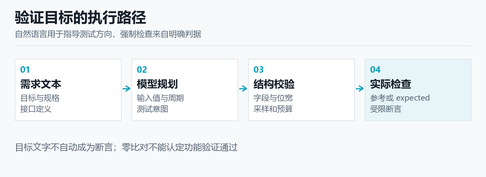

图5　规格和合约进入AI状态，结构动作经过权限与预算校验；模型不提供最终裁决真值。

| 输入或动作 | 约束 | 保存内容 |
| --- | --- | --- |
| 正确规格与目标 | 明确优先级、延迟和边界 | 原文本与登记版本 |
| 追加输入 | 允许信号、数值、向量和周期 | reason、vectors及校验结果 |
| 停止 | 由受限调度记录停止理由 | 终态与此前实际执行 |
| 格式或预检拒绝 | 固定诊断、额度允许时重新提案 | 可安全原文或SHA／长度、错误码及收费记录 |

来源：[docs/competition/ic/v3/material_data.json](../../../../docs/competition/ic/v3/material_data.json)；[docs/experiment/agent_new_holdout_study_plan_2026-10-05.md](../../../../docs/experiment/agent_new_holdout_study_plan_2026-10-05.md)；[src/iverilog_ai/ai/agent.py](../../../../src/iverilog_ai/ai/agent.py)；[src/iverilog_ai/ai/provider.py](../../../../src/iverilog_ai/ai/provider.py)；[docs/experiment/deepseek_decision_v4_2026-10-04.md](../../../../docs/experiment/deepseek_decision_v4_2026-10-04.md)。

<!-- pagebreak -->

## 七、独立判据：FIFO纠错与逐拍检查

**先验证裁判，再用真实输出判断设计；独立表达避免重复RTL中的同一错误。**

参考模型必须从正确规格推导，而不是照抄被测RTL。FIFO曾在同拍读写均被接受时产生占用量错误；如果参考也复制寄存器赋值顺序，双方可能同时错误而比较一致。独立队列使用边沿前空满状态决定读写接受，然后更新队列。两个操作同时接受时，先取旧队首，再加入新数据，长度保持不变，直接对应FIFO语义。

已保存的见证中，边沿前队列为25、66，同拍读出25并写入99，边沿后队列应为66、99，占用量仍为2。原计数实现没有维持这一条件。76刺激拍、228项输出比较中，修复前出现66项差异，修复后为零；正确基线和随后重新产生的单点变体分别留存。这是独立判据与人工修复的成果，不计为AI新增缺陷发现。

执行流程还从段末观察改为每拍边沿后比较全部真实输出。一个向量持续多拍时，中间任何一拍都可能出现valid、busy、full或数据差异。参考按照实际输入和边沿关系逐拍复算，将周期、信号、期望值和实际值放入反例。只看段末可能遗漏已恢复的短暂错误，逐拍记录则使复核者能定位第一次不一致及后续状态。

外部有限规格也有类似经验。补齐UART位持续时间和busy释放检查后，三个外部模块类别中的15个人工变体检出从13提高到15。三正确基线和三等价改写无误报，三编译失败仍不可判定。这里的提升来自人工补判据，使用同字节24目标，没有新API请求，也不是外部独立盲测或AI泛化结论。

判据的适用范围必须随着结果一起报告。原四类开发配置有FIFO7、UART6、SPI6、握手5，共24项有限功能场景，来自真实事件采样，并不是代码覆盖率或正确性证明。最新两类模块没有定制覆盖bins，其状态为unsupported或unknown。增加参考支持之前，应先核对合约与采样时点，再以正确、缺陷和不可判定控制检查判据自身。

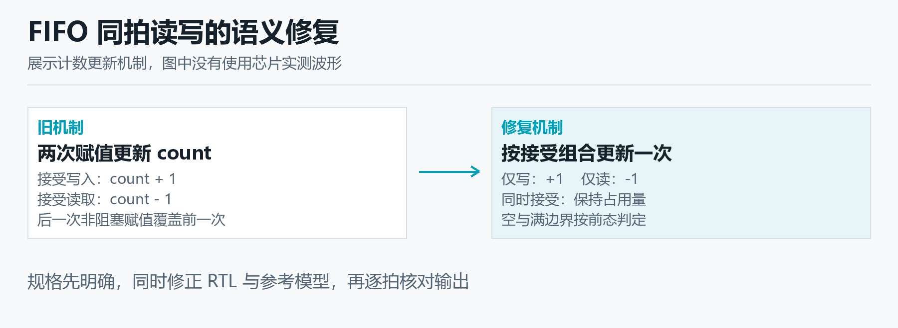

图6　FIFO同拍接受读写的独立队列语义及纠错记录；66→0是228项比较的差异数，不是AI检出率。

| 证据 | 实际记录 | 正确解释 |
| --- | --- | --- |
| FIFO独立队列 | 76刺激拍，228比较；66差异→0 | 基线纠错与有限向量验证 |
| 外部有限规格 | 15人工变体：13→15检出 | 人工补判据，0新增API |
| 四类功能场景 | 7＋6＋6＋5＝24项 | 有限事件观察，非代码覆盖率 |
| 最新两模块 | 无定制coverage bins | 覆盖unsupported／unknown |

来源：[docs/experiment/protocol_oracle_improvements_2026-10-04.md](../../../../docs/experiment/protocol_oracle_improvements_2026-10-04.md)；[docs/experiment/functional_coverage_2026-10-04.md](../../../../docs/experiment/functional_coverage_2026-10-04.md)；[docs/competition/ic/v3/material_data.json](../../../../docs/competition/ic/v3/material_data.json)；[src/iverilog_ai/core/reference_model.py](../../../../src/iverilog_ai/core/reference_model.py)。

<!-- pagebreak -->

## 八、反馈Agent：有限观察与独立补测

**反馈来自真实端口，补测仍受同一合约、周期和请求额度约束。**

Agent每次获得合法计划后，工具重新建立DUT并自动复位，再施加该计划。当前比较使用独立episode，上一轮电路寄存器状态不会延续到下一轮；历史输入和已保存的观察仍进入轨迹。模型可以根据之前经历提出新组合，但它不能要求延续一个未归档的内部状态。每轮独立复位也使另一人能够按单轮计划复查反例。

通用端口摘要读取明确合约中的真实输入输出，保留完整位串及X、Z。选择规则使用端点与均匀间隔，最多12个时间样本，并报告省略数量；它不读取期望值、不推测内部状态，也不挑选最能暴露缺陷的位置。固定采样规则降低了人工选择反馈的自由度，同时承认有限摘要可能遗漏瞬态，最终判定仍使用完整逐拍执行记录。

摘要把计划、合约、RTL、测试台与执行工件交叉绑定，重解析stdout并核对采样包。缺文件、指纹不符、采样缺行、顺序冲突或执行未完成时，返回证据不足和安全错误码，不能补造端口值。采样规则、返回样本和省略数量一同保存，让复核者能够判断反馈内容是否来自本轮执行，避免把其他计划的观察拼入当前状态。

最新两模块有80轮完整端口摘要，真正传给模型端口反馈的是20次收费请求。生成摘要数量不等于模型接收次数，也不等于任务数。无反馈策略的31次请求不接收观察或拒绝诊断，但仍知道自身历史计划和预算，并受执行器检出早停影响。这个对照能够描述本实现的反馈差异，不能说无反馈组没有任何运行信息约束。

最新反馈组11项检出中，6项发生在首轮，5项发生在第二轮，说明闭环确实能提出后续可执行补测。它不证明这5项全由端口摘要造成：请求次数、输入选择、拒绝恢复和随机性也可能影响结果。下一阶段应扩大外部模块和重复，事前固定预算、采样与策略，只在完整对照范围内评价反馈作用。

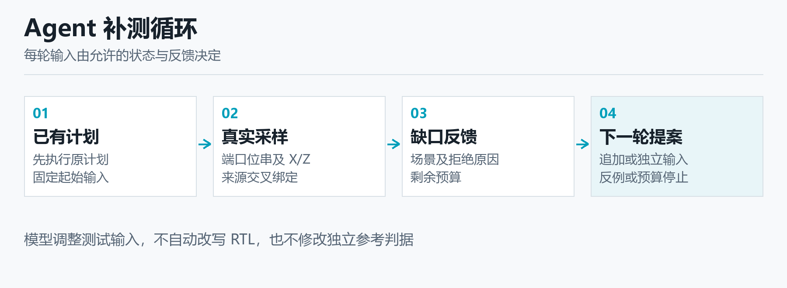

图7　受控闭环：提出、校验、独立复位执行、生成真实摘要、补测或停止；第二轮重新建立电路状态。

| 环节 | 已保存事实 | 边界 |
| --- | --- | --- |
| 通用摘要 | 80轮完整文档 | 最多12时间样本，非全量反馈 |
| 实际传入模型 | 20次收费请求含端口反馈 | 摘要生成与发送次数分开 |
| 反馈检出 | 首轮6项，第二轮5项 | 可执行补测，非因果证明 |
| 无反馈对照 | 31请求不收观察或拒绝诊断 | 仍保留计划、预算与早停约束 |

来源：[docs/experiment/agent_new_holdout_study_live_2026-10-05.md](../../../../docs/experiment/agent_new_holdout_study_live_2026-10-05.md)；[docs/review/agent_new_holdout_study_review_2026-10-05.md](../../../../docs/review/agent_new_holdout_study_review_2026-10-05.md)；[src/iverilog_ai/core/observation_feedback.py](../../../../src/iverilog_ai/core/observation_feedback.py)；[docs/competition/ic/v3/material_data.json](../../../../docs/competition/ic/v3/material_data.json)。

<!-- pagebreak -->

## 九、恢复与预算：失败请求也进入账本

**把格式、计划预算和传输分别处理，用共享账本保留所有实际消耗。**

模型可能返回格式错误，合法结构也可能超过剩余刺激周期或向量额度。系统不裁剪或执行被拒绝的计划。额度允许时才重新提案，拒绝原因、模型用量和此前执行保留；可安全留存的响应存原文，阻断原文仅留SHA、长度与错误码。历史v5有1份未存原文，v6有3份仅hash，不能称全部原文齐全。恢复是新收费请求，登记实验的自动传输重试为零。

最新87次请求中，85个动作通过schema，2个格式拒绝；5个计划预算拒绝属于schema通过后的预检子集，不能把85、2、5相加当请求数。预算拒绝后有2任务进入实际执行，其中1项检出；格式拒绝后有1任务执行2轮，未检出。第108任务以格式失败结束，但此前1轮、14刺激拍仍保留在完整分母中。

各API策略共享本批100万输入加输出tokens，发送前进行保守预留，收到有效usage后按输入加输出结算。缓存命中、未命中字段是输入的子项，不再重复相加；缺少usage时保留未知预留，不能把未结算当零。最新实际301910输入、37714输出，合计339624，剩余660376，未知与待结算均为零。

历史432任务的306请求消耗973149tokens，剩余26851，属于另一独立登记批次，不扣入最新账本，也不能将多个批次拼成一个额度结果。共享账本使晚序任务可能受到剩余额度影响，执行完整性需要另行报告。未使用余额不会自动授权挑选失败补跑；如要评价新版，应重新登记完整策略、成员顺序、刺激和请求限制。

10月13日网页增加使用服务端默认输出长度的选项，选择后不发送单次输出上限字段，服务商仍可能限制回复。该选项不等于撤销累计预算，也不改变已封存实验4096输出上限、60秒超时等设置。输出上限、累计token、请求数、刺激拍数是不同限制。账本记录模型报告用量，没有服务商账单，不能推算真实支出或宣称节省成本比例。

图8　请求预留、usage结算与未知用量保留；拒绝和失败消耗仍计入对应登记批次。

| 项目 | 最新108 | 历史432 |
| --- | --- | --- |
| 实际API请求 | 87 | 306 |
| 输入加输出tokens | 339624 | 973149 |
| 各批登记上限 | 1000000 | 1000000 |
| 各批剩余额度 | 660376 | 26851 |
| 未知／待结算 | 0／0 | 0／0 |

来源：[docs/experiment/agent_new_holdout_study_budget_2026-10-05.json](../../../../docs/experiment/agent_new_holdout_study_budget_2026-10-05.json)；[docs/experiment/agent-new-holdout-study-live-2026-10-05/trace_manifest.json](../../../../docs/experiment/agent-new-holdout-study-live-2026-10-05/trace_manifest.json)；[docs/experiment/agent-feedback-study-live-2026-10-05/token_budget.json](../../../../docs/experiment/agent-feedback-study-live-2026-10-05/token_budget.json)；提交d9ffded；[src/iverilog_ai/ai/provider.py](../../../../src/iverilog_ai/ai/provider.py)。

<!-- pagebreak -->

## 十、应用成效：最新108任务公平对照

**对六策略使用同一任务集合，同时报告正确控制、失败和实际执行。**

最新集合包括两级有效数据流水与许可事件累计器两个内部合成模块，每模块有正确目标及两个语义缺陷，重复三次并采用六策略，共108任务。每策略的12缺陷任务是四个不同缺陷各重复三次，另有6正确控制；重复执行不是12个不同设计缺陷。Agent、端口反馈helper和系统提示先冻结于a969337，实际执行源码为20400fa。

流水模块要求8位数据、连续有效输入与空泡、flush优先及无效数据清零；累计器为4位模16累计，仅许可事件增加，clear不受enable限制且优先。两模块各任务累计刺激均上限24拍，single最多1请求，反馈和无反馈Agent最多3请求；每个新计划独立复位。六策略共享任务和判据，实际刺激总量见表，不将相同上限解释为实际资源完全相等。

六策略检出依次为12、10、8、8、11、10，分母均为12。固定测试最好；反馈比均匀随机和无反馈各多1个重复缺陷任务，比单次API多3个。三次重复中的反馈为4、4、3，单次API为2、2、4，提示计划随机性和有限样本波动。各组实际周期与请求不同，应连同检出解读；这些描述性差值没有独立统计检验或因果证据，不能称稳定优于随机。

108任务均实际执行，共134轮、268个实际DUT与正确参考执行侧。六组共36/36正确控制均有执行且误报零。严格比较资格true意味着当前规则要求的双侧证据完整，并不表示每个模型动作、预检或终态都成功；一项终态格式失败及此前有效执行仍保留。正确控制通过也只覆盖已登记参数和输入，不证明所有行为正确。

最新两类模块与五个历史API批次的模块集合互斥，但均由同团队合成，没有外部作者、外部盲测或预训练未见的证据，也没有独立时间戳证明模块选型早于旧成绩。当前可支持的结论是受控闭环和完整证据能够运行，新模块中取得有限检出；扩大设计来源与作者独立性后，才能继续讨论泛化价值。

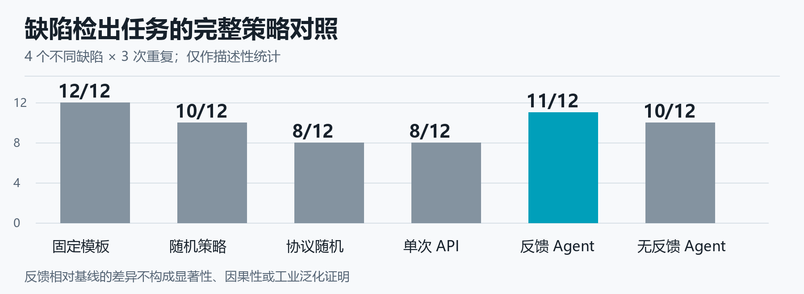

图9　最新108任务：各策略12重复缺陷任务的检出数；分母来自4个不同缺陷×3重复，固定测试领先。

| 策略 | 检出／12 | 三次各／4 | API请求 | 实际刺激拍 |
| --- | --- | --- | --- | --- |
| 固定测试 | 12 | 4／4／4 | 0 | 432 |
| 均匀随机 | 10 | 4／3／3 | 0 | 432 |
| 协议随机 | 8 | 4／2／2 | 0 | 432 |
| 单次API | 8 | 2／2／4 | 18 | 236 |
| 反馈Agent | 11 | 4／4／3 | 38 | 300 |
| 无反馈Agent | 10 | 3／3／4 | 31 | 290 |

来源：[docs/experiment/agent_new_holdout_study_live_2026-10-05.md](../../../../docs/experiment/agent_new_holdout_study_live_2026-10-05.md)；[docs/experiment/agent_new_holdout_study_plan_2026-10-05.md](../../../../docs/experiment/agent_new_holdout_study_plan_2026-10-05.md)；[docs/experiment/agent-new-holdout-study-live-2026-10-05/receipt.json](../../../../docs/experiment/agent-new-holdout-study-live-2026-10-05/receipt.json)；[docs/review/agent_new_holdout_study_review_2026-10-05.md](../../../../docs/review/agent_new_holdout_study_review_2026-10-05.md)。

<!-- pagebreak -->

## 十一、历史批次：执行完整性与对照结果

**将较大历史集合单列，保留无执行任务和反馈没有领先的事实。**

历史八模块批次在a969337上登记432任务。每策略有48缺陷任务，来自16个不同人工缺陷各重复三次，另有24正确控制；六策略和分母与最新两模块分别定义。这些模块此前已暴露，不能改称最新留出，也不能与108任务合并计算总体检出率。模块复杂度、缺陷和预算轨迹不同，跨批次数字不构成性能提升的直接证据。

六策略的历史检出为48、32、48、29、37、37。反馈高于均匀随机和单次API，但低于固定与协议随机，并与无反馈相同。历史反馈没有形成整体优越性证据；对更强的协议随机基线尤其没有领先。固定和协议随机的结果也提示，结构化的人工协议知识对这些有限任务十分有效，作品需要说明AI的补测和交接价值，而非只选有利基线。

432任务中414项有实际执行，18项零DUT；共有484轮、968执行侧，严格比较资格false。正确控制实际执行143/144，误报零；未执行的一项不能算通过。仅有任务终态、源指纹未变或摘要表格，不能填补缺失的真实仿真。完整分母中保留格式、预算、策略错误和未执行任务，使读者能判断检出数背后的可执行程度。

本批306次实际请求消耗973149tokens，未知与待结算零。所有API组共享100万额度，晚序任务可能受余额影响，因此固定顺序、请求上限、周期限制和停止机制都是结果解释的一部分。反馈122请求、无反馈114请求，检出却同为37，不能从多调用推断多收益，也不能把未用余额用于事后只补漏检项。

这份历史记录给出下一步的实验约束：先预登记外部规格与策略，再保留所有失败，分别评价执行率、功能检出、正确控制和资源消耗。工程修复可以提高稳定与可复查性，但如果要证明新版模型效果，需要在新完整批次重新运行；不能把10月7日样式维护、10月13日界面改动或较小新集合的数字归因为模型性能提升。

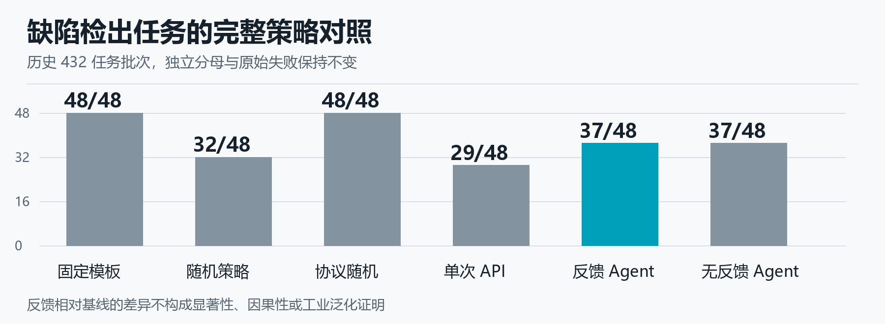

图10　历史432任务：各策略48重复缺陷任务的检出数；反馈与无反馈相同，固定和协议随机领先。

| 策略 | 检出／48 | 请求 | 输入加输出tokens |
| --- | --- | --- | --- |
| 固定测试 | 48 | 0 | 0 |
| 均匀随机 | 32 | 0 | 0 |
| 协议随机 | 48 | 0 | 0 |
| 单次API | 29 | 70 | 205503 |
| 反馈Agent | 37 | 122 | 426581 |
| 无反馈Agent | 37 | 114 | 341065 |

来源：[docs/experiment/agent_feedback_study_live_2026-10-05.md](../../../../docs/experiment/agent_feedback_study_live_2026-10-05.md)；[docs/experiment/agent-feedback-study-live-2026-10-05/receipt.json](../../../../docs/experiment/agent-feedback-study-live-2026-10-05/receipt.json)；[docs/review/agent_feedback_study_review_2026-10-05.md](../../../../docs/review/agent_feedback_study_review_2026-10-05.md)；[docs/competition/ic/gap_checklist.md](../../../../docs/competition/ic/gap_checklist.md)。

<!-- pagebreak -->

## 十二、工程改进：维护、搬运与真实CI

**工程成熟度来自可复查的运行条件修复，不能替代模型效果或用户验收。**

最新实验源码的既有验收为2033通过、2跳过、零失败，mypy检查88文件零错误，535指纹未变。结果审计另有2192项不同非DUT核心检查，入口作者核对54轨迹、87请求；这些职责与全仓测试分开，不相加，也不是独立人工H02。验收说明登记源码和证据的检查结果，不自动覆盖后来的所有提交。

10月7日把六份RTL的12项命名及组合表达问题修在独立维护版，原实验源码与成绩保留。严格静态门禁零错误、零警告，六项passed、两项not_requested。首次与公开重放各36次DUT，同组每轮5115比较一致；72次执行包含重复，不是72个独立样本。18份规格文件逐字节重建，故意缺陷仍按正确规格失败，门禁通过不等于功能正确。

同机干净克隆在独立环境和含空格目录中修复长路径、锁依赖、换行、Yosys命令引用及虚拟环境扫描。最终2020通过、16跳过、零失败，14份登记输入原字节匹配；14项旧外部输入未随Git提供，不能补造或算通过。同一电脑的新目录和环境有助于检查搬运条件，但仍不是第二台设备首次安装或真人完整复现。

真实GitHub runner又暴露缺pytest、编码、Windows安装路径、浅历史和冻结辅助器D盘假设。修复使用锁依赖、明确工具探测与运行期路径适配，并保留失败日志。旧216438d提交的云端检查曾全部通过，这属于历史工程改进；当前df7ccfa对应verify与CI均已completed/failure，当前提交云端未通过，不能引用旧绿色状态替代。已读取的失败日志指出冻结v8 Agent或helper、系统提示的字节守门与当前维护代码不一致；这需要继续处理历史资产回归与新版代码的兼容边界，不把它直接解释为旧实验原件被修改。

维护与CI迭代的价值是让工具条件明确、失败更早、记录可交接。它们没有产生新的模型成绩，也没有形式等价、物理时序、功耗或硬件证据。下一步应定位当前云端失败，保存具体任务原因和修复后的新回执，再安排异机完整运行；每个检查层按对应提交和实际执行记录报告。

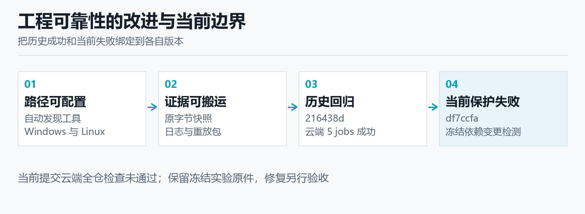

图11　工程证据按版本和验证层分开；当前提交云端检查失败，旧成功与同机复现不替代新结果。

| 工程证据 | 实际结果 | 适用边界 |
| --- | --- | --- |
| 最新实验源码验收 | 2033通过／2跳过；mypy88 | 属于登记实验源码 |
| 独立RTL维护版 | 6源静态0/0；每轮5115比较一致 | 原／新有限向量，重复重放 |
| 同机干净克隆 | 2020通过／16跳过；14原字节匹配 | 同一电脑，旧输入跳过 |
| 当前df7ccfa云端 | verify38338658309、CI38338659290失败 | 按当前提交，不沿用旧绿色 |

来源：[docs/experiment/agent_new_holdout_source_validation_2026-10-05.md](../../../../docs/experiment/agent_new_holdout_source_validation_2026-10-05.md)；[docs/review/agent_new_holdout_study_review_2026-10-05.md](../../../../docs/review/agent_new_holdout_study_review_2026-10-05.md)；[docs/experiment/rtl_style_maintenance_2026-10-07.md](../../../../docs/experiment/rtl_style_maintenance_2026-10-07.md)；[docs/experiment/clean_checkout_2026-10-08.md](../../../../docs/experiment/clean_checkout_2026-10-08.md)；[docs/experiment/github_actions_repair_2026-10-08.md](../../../../docs/experiment/github_actions_repair_2026-10-08.md)；[docs/competition/ic/v4/evidence_audit.json](../../../../docs/competition/ic/v4/evidence_audit.json)。GitHub任务verify38338658309与CI38338659290为2026-10-13实际状态。

<!-- pagebreak -->

## 十三、真实使用：异机11项问题与两次失败

**真实操作提供产品改进依据；协助、失败与缺失记录共同构成证据。**

用户明确说明在另一台电脑操作，并提供终端输出、截图、文字反馈和两个运行证据包。操作包含AI安装提示与解释，因此可称真实异机操作记录，不能称无协助完成、独立第三方完整复现或独立H02。设备身份未独立核验，完整计时、人员关系、经验、任务登记和当时源码commit尚未齐全，未知项不能按零协助或成功补齐。

11项问题覆盖工具准备、安装网络错误、PATH、工具用途、旧D盘配置、工程目录、缺少子模块、判据缺失、首屏过长、操作入口较深和灰色按钮难辨识。首次Git、uv、Icarus、vvp未找到，Python命中WindowsApps别名；后续已有部分版本输出。Icarus加入本次终端PATH后恢复，不能由此推出重启后仍有效或所有安装任务完成。

两包上传的是同一RTL指纹，内部依赖one_wire_master_bit缺失，两次均在RTL第144行编译失败，退出码2，run为null、结果记录零且无VCD。首个计划有7向量、37个expected字段，第二个4向量的expected与assertions均空。第二测试台生成的12条固定ok:true观察语句没有执行，也没有检查字段，不能解释为12次功能通过。

开发侧核对两个manifest各8文件，大小与SHA全部一致，共16/16。该结果支持证据包文件完整性，不代替真实仿真、用户任务完成或独立人审。两个包是同RTL的不同运行，不代表两个参与者或两次功能成功；后一次失败保留为新记录，不覆盖首次问题。界面和编译预检查已发布，但尚无用户使用新版的确认输出。

后续复测应先记录实际版本和环境，再提供完整依赖输入与可核查输出判据，依次保存预检、编译、仿真和实际比较数量。界面需单独确认用户是否找得到下一步，以及按钮状态是否清楚；协助内容、时间和本人反馈按真实记录填写。在材料不足前，不公布人数、完成率、无协助率、满意度或耗时统计。

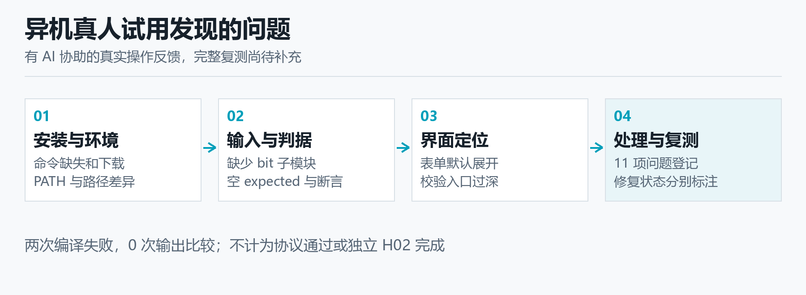

图12　真实异机问题按阶段归类；两条执行证据均停止在编译，修复后的用户复测尚未确认。

| 问题范围 | 代表现象 | 当前状态 |
| --- | --- | --- |
| 环境与路径PC-01—06 | 缺命令、PATH、旧D盘和目录顺序 | 部分恢复有输出，完整验证待补 |
| 源码与判据PC-07—08 | 缺子模块；后次空expected／assertions | 两次compile_failed，仍无仿真 |
| 界面PC-09—11 | 默认展开、入口深、灰按钮不明显 | 调整已发布，异机复测待补 |
| 证据包核对 | 同RTL；manifest16/16一致 | 文件完整性，非功能或人员通过 |

来源：[docs/trial/other_pc_user_trial_2026-10-13.md](../../../../docs/trial/other_pc_user_trial_2026-10-13.md)；[docs/trial/results.md](../../../../docs/trial/results.md)；[docs/trial/forms/reproduction_record.md](../../../../docs/trial/forms/reproduction_record.md)。原ZIP、截图和个人路径私有保存，公开报告仅使用脱敏摘要。

<!-- pagebreak -->

## 十四、产品改进：把卡点转成可操作步骤

**根据实际问题调整界面、守门和手册，区分已实施改动与尚未测量的收益。**

首屏默认展开端口、时钟和源码，用户需要滚动寻找下一步。7059d25将端口与时钟、接口JSON与导出、导入提示和案例源码等详细区域默认折叠，把生成JSON和校验动作放到更直接的位置。折叠不是减少接口信息，用户仍能展开编辑；实现目标是让主要操作可见，实际可找性改善需要用户在新版确认，不能据代码变化宣称体验成功。

计划入口现在要求自定义接口先校验，合约为空或模块名不符时给出具体提示。编辑JSON会撤销确认并刷新后续状态，减少使用旧合约的机会。f75f619把编译预检查前置，使缺少依赖时先显示工具证据。这些改变把原先在深层运行才暴露的问题移到更早阶段，属于可检查的流程变化，没有实测节省时间百分比。

d9ffded为网页与Agent增加服务端默认输出长度选项。使用者可以控制是否发送max_tokens或max_output_tokens，同时保留请求超时、模型模式和诊断配置；服务端仍可能截断或限制输出。单次回复上限与累计预算不同，公开手册说明两者含义。旧完整实验仍以原登记参数解释，不能因为新选项上线就改写旧设置或取消公平额度。

最近三轮手册修订分别更新当前流程、客观标题和解释性文字，覆盖入门、进阶、深度与按目标查找的入口。内容明确工程根目录、工具发现、生成方式、判据来源和三层结果语义，避免把运行完成、没有错误级失败或导出成功写成电路正确。df7ccfa则把实际异机问题整理为脱敏记录，使开发改动可以回到具体原始现象。

用户价值目前有可见的工程依据：更早暴露不可编译输入，关键动作不再埋在长表单内，停止阶段和期望值来源更容易解释，失败工件可以交接。尚未取得新版异机复测、操作耗时、满意度或推广数据，因此这些是实现变化及预期作用。接下来应对每项问题关联新运行记录，保存仍需协助的步骤，按真实效果决定进一步调整。

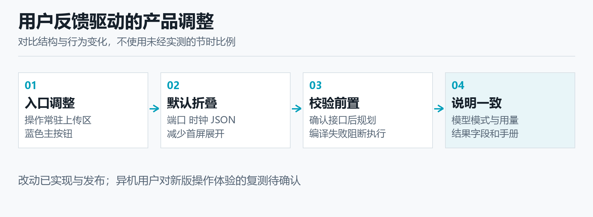

图13　问题→改动→复测的闭环；已发布表示实现状态，用户效果仍需对应新记录。

| 触发问题 | 已实施变化 | 待取得证据 |
| --- | --- | --- |
| 首屏长、入口深 | 默认折叠；前置生成与校验 | 用户能否找到下一步 |
| 缺模块后才失败 | 上传RTL编译预检查 | 完整依赖与新版编译结果 |
| 合约状态不明确 | 空接口／模块名检查；编辑撤销确认 | 修改后操作是否清楚 |
| 设置与结果难理解 | 输出选项、三层语义与手册修订 | 独立阅读与实际操作反馈 |

来源：提交7059d25、d9ffded、2c6a4d9、671512e、d763530、df7ccfa及f75f619；[ui/app.py](../../../../ui/app.py)；[docs/manual/01_beginner.md](../../../../docs/manual/01_beginner.md)；[docs/manual/02_advanced.md](../../../../docs/manual/02_advanced.md)；[docs/manual/03_deep.md](../../../../docs/manual/03_deep.md)；[docs/manual/04_by_goal.md](../../../../docs/manual/04_by_goal.md)；[docs/trial/other_pc_user_trial_2026-10-13.md](../../../../docs/trial/other_pc_user_trial_2026-10-13.md)。

<!-- pagebreak -->

## 十五、落地路线：资源、验证与未完成工作

**下一阶段先补关键证据，再扩大应用；所有成本与推广收益均作为计划。**

近期工作先闭合当前失败。云端verify和CI需按具体任务日志定位、修复并保存对应新提交的实际结果；异机用户需补齐子模块、输出判据和版本记录，重新执行完整流程。首次失败与复测分别留存，不能用新成功覆盖旧现象。独立人工H02邀请非对应功能实现者从规格、变体、判据和统计抽查，不以代理审计代签。

中期验证应扩大设计来源：选择外部作者的有限规格模块，先登记正确行为、参数、策略、成员顺序、随机种子、刺激与API预算，再执行完整批次。正确、等价改写、人工缺陷和编译失败控制继续分开。只在同批同条件下比较执行率、检出和消耗，足够设计数量与重复之后再讨论统计；对没有参考授权的接口保持不可判定。

运行资源主要为Python与锁依赖、uv、Icarus和vvp，网页依赖Streamlit；Yosys用于可选综合，GTKWave用于波形查看，规格图重建使用固定Node与WaveDrom依赖。在线规划另需使用者配置API凭据，离线规则和已有证据核对可不新增模型请求。当前没有硬件需求的结果，后续若上板或时序验证，应另登记设备、约束和实际工具日志。

组织资源需要实施者维护工具，真实使用者执行任务，非对应功能实现者复核判据与分母。试用应记录任务分配、环境、计时、协助、反馈和引用授权，私人原件与公开脱敏摘要分别保存。真人试用和H02是本项目的证据补强工作，官方规则未将它们列为额外硬门槛；正式队号、报名赛题、材料命名和上传回执仍由提交者核实。

进一步产品化可以规划安装引导、依赖文件清单、判据模板、反例阅读和团队归档，但没有服务商账单、收入、用户规模或节省成本测量，不能填入经济收益。视频、实体手机、外部仓库调用Action、复杂SoC和工业部署也各需实际证据。阶段推进以新的可复查回执为依据，收益评价从真实任务数据开始。

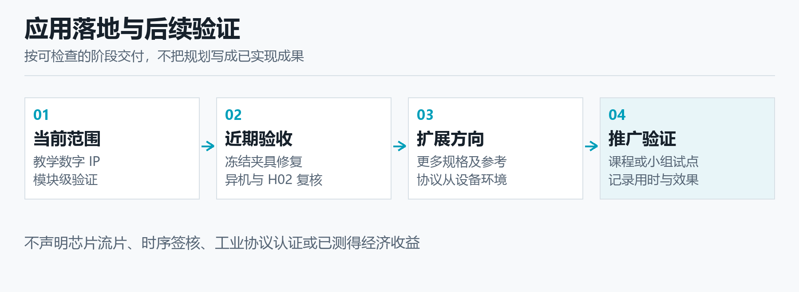

图14　后续路线按证据关卡推进：当前失败闭合→完整异机与人工复核→外部设计对照→扩大应用。

| 阶段 | 计划工作 | 完成判据 |
| --- | --- | --- |
| 近期 | 当前CI修复与异机复测 | 新提交任务结果；完整执行与比较 |
| 审核 | 独立人工H02与真实试用记录 | 本人确认、异议、协助和原件 |
| 扩展 | 外部规格模块的完整预登记对照 | 同批公平分母、预算和全部失败 |
| 应用 | 安装引导、视频与团队证据交接 | 实际任务效果及资源记录 |

来源：[docs/competition/ic/gap_checklist.md](../../../../docs/competition/ic/gap_checklist.md)；[docs/trial/other_pc_user_trial_2026-10-13.md](../../../../docs/trial/other_pc_user_trial_2026-10-13.md)；[docs/review/independent_review_guide.md](../../../../docs/review/independent_review_guide.md)；[docs/reproduce_current.md](../../../../docs/reproduce_current.md)；[docs/reproduce_windows_setup.md](../../../../docs/reproduce_windows_setup.md)。官方提交要求以[官方主题赛通知](https://www.aicomp.cn/notice/4756.html)当前通知与附件为准。

<!-- pagebreak -->

## 十六、总结与附录：创新、资源和参考资料

**作品贡献是把AI建议、真实执行和独立证据接成可复查流程，并清楚报告限制。**

本作品完成了四项可以在原件中核对的能力：规格与合约进入受限测试规划，合法输入进入实际逐拍仿真，独立参考解释差异，全过程以原输入、工具日志、反例和用量交接。通用端口反馈无需为每个新模块把缺陷见证写进提示词；格式与预算恢复保留收费失败，既让闭环继续，也让审核者看到为何停止。

创新体现为验证链各层之间的可信关系，而不是宣称模型自身会证明电路正确。FIFO独立队列纠错说明判据也需验证，逐拍检查避免只看段末，来源绑定减少文件错配，共享账本约束实际模型消耗。由异机操作推动的编译预检查、接口守门、折叠表单和手册修订，则把技术链改进转为使用者能执行的步骤。

应用结果与资源见第10—11页，工程及真实操作证据见第12—13页。完整分母让未执行、格式失败和有效检出能够在同一批次解释，避免只用成功样本评价系统；实际刺激与请求列帮助复核者区分上限和消耗。保留较强的固定、协议随机基线也使AI价值需要以可执行补测和交接证据说明，而不是由一项有利计数推出普遍优势。

迭代记录把设计验证与工具使用两类问题联系起来：判据错误要求独立语义与控制样本，执行缺口要求守门和真实日志，环境假设要求锁依赖与路径探测，用户卡点要求入口和手册调整。当前云端失败与异机复测待补仍见第12—13页。下一阶段用新提交回执、完整用户复测和外部预登记对照，逐项验证这些改进是否达到预期作用。

复查时先读事前方案和实际设置，核对完整任务成员，再核对原始ZIP与manifest、处理后的receipt和strict_summary、每轮两侧日志与波形，最后检查轨迹及共享账本。最新实验源码为20400fa，Agent锚定a969337；材料版本不等于实验版本。下表区分原始数据、处理记录、关键代码和AI资源，官方通知、规则及技术大纲由官方入口核对。

参考资料以仓库根相对路径和官方入口列示；本地原件与公开摘要的范围以各回执为准。

| 参考资料 | 用于核对 |
| --- | --- |
| 官方通知及附件；Icarus官方资料 | 主题、规则、大纲及工具背景；链接见来源 |
| 原始数据：full_raw_evidence.zip＋full_raw_manifest.json | 注册输入、两侧日志、波形与响应记录；逐文件SHA |
| 处理记录：receipt.json＋strict_summary.json＋evidence_audit.json | 任务汇总、严格资格、用量及本轮只读复核 |
| 关键代码：[src/iverilog_ai/ai/agent.py](../../../../src/iverilog_ai/ai/agent.py)；[src/iverilog_ai/core/executor.py](../../../../src/iverilog_ai/core/executor.py)；[src/iverilog_ai/core/reference_model.py](../../../../src/iverilog_ai/core/reference_model.py) | 受限决策、真实执行与独立逐拍参考 |
| AI资源：DeepSeek API／deepseek-flash（4.1f） | API推理；不训练、不微调、无本地模型权重 |
| 工程与用户：第12—13页所列报告 | 维护与搬运、当前CI失败、11项异机问题 |

资料路径均相对仓库根。最新原始与处理数据：[docs/experiment/agent-new-holdout-study-live-2026-10-05/full_raw_manifest.json](../../../../docs/experiment/agent-new-holdout-study-live-2026-10-05/full_raw_manifest.json)；[docs/experiment/agent-new-holdout-study-live-2026-10-05/full_raw_evidence.zip](../../../../docs/experiment/agent-new-holdout-study-live-2026-10-05/full_raw_evidence.zip)；同目录receipt.json与strict_summary.json。审核：[docs/review/agent_new_holdout_study_review_2026-10-05.md](../../../../docs/review/agent_new_holdout_study_review_2026-10-05.md)；[docs/competition/ic/v4/evidence_audit.json](../../../../docs/competition/ic/v4/evidence_audit.json)。官方：[官方主题赛通知](https://www.aicomp.cn/notice/4756.html)及[官方时间调整通知](https://www.aicomp.cn/notice/notice-3/5435.html)；Icarus：[Icarus Verilog官方资料](https://steveicarus.github.io/iverilog/)。

## 附录A　规格波形：把文字行为转成时序关系

两模块已有规格图的真实浏览器渲染，帮助检查优先级、延迟和采样含义。

波形图对应正确A版本的公开规格，使用固定WaveDrom 3.6.1依赖生成SVG，再经浏览器实际显示取得截图。图中的八拍示例假定复位已完成，数值来自既有规格；它们用于解释应有行为，与真实仿真VCD分别归档。

有效数据流水图表达有效输入和空泡交错、数据延迟以及flush优先；事件累计器图表达许可事件增加、clear优先和输出累计值。将文字与图并列，便于复核者发现规格歧义，再回到逐拍参考和执行日志核对。

图15　有效数据流水规格：E0采集、E1输出，flush具有优先级。截图保留完整信号名与示例数值。

图16　许可事件累计器规格：只有被许可事件累计，clear优先。此图没有展示完整回绕与复位激励。

来源：docs/experiment/rtl_spec_rendering_2026-10-07.md；docs/experiment/rtl-spec-rendering-2026-10-07/rendering_receipt.json。既有渲染工作0新增API、0新增DUT，本次报告仅引用原图。两A源码与2026-10-05实验原件逐字节一致。

## 附录B　实际界面：默认入口与导入后的关卡

2026-10-13本机浏览器观察，展示已实施流程；不代替异机用户复测。

首次进入页面时默认选择在线模型，进入对应配置；导入公开有效数据流水A版后，主要操作显示蓝色按钮，端口与时钟等详细内容默认收起。接口尚未确认时，生成计划按钮保持禁用，并给出下一步提示。

本次仅打开页面、导入公开RTL并观察界面，工具进行了不执行DUT的编译预检查。未点击模型计划生成或正式仿真，未新增API请求和功能检出；现场截图用于核对实现状态，不能说明操作耗时、满意度或真人复测完成。

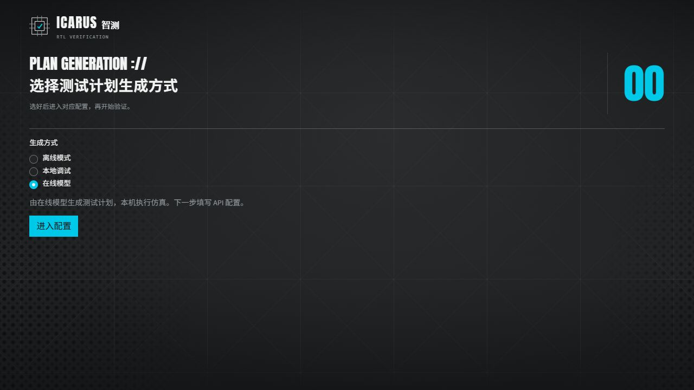

图17　实际首次进入界面：在线模型为默认项，使用者先进入相应配置。

图18　实际导入后的工作区局部视口：校验接口、从表格生成JSON为蓝色；接口确认前，生成计划禁用。

来源：本版screenshots目录两张实际浏览器截图；源码状态df7ccfa。导入文件benchmarks/agent_new_holdout_20261005/targets/valid_data_pipeline/A/valid_data_pipeline.v。仅用于界面观察，非新的实验批次、异机复现或人工H02。
